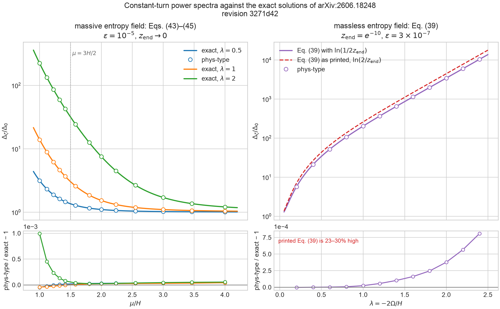
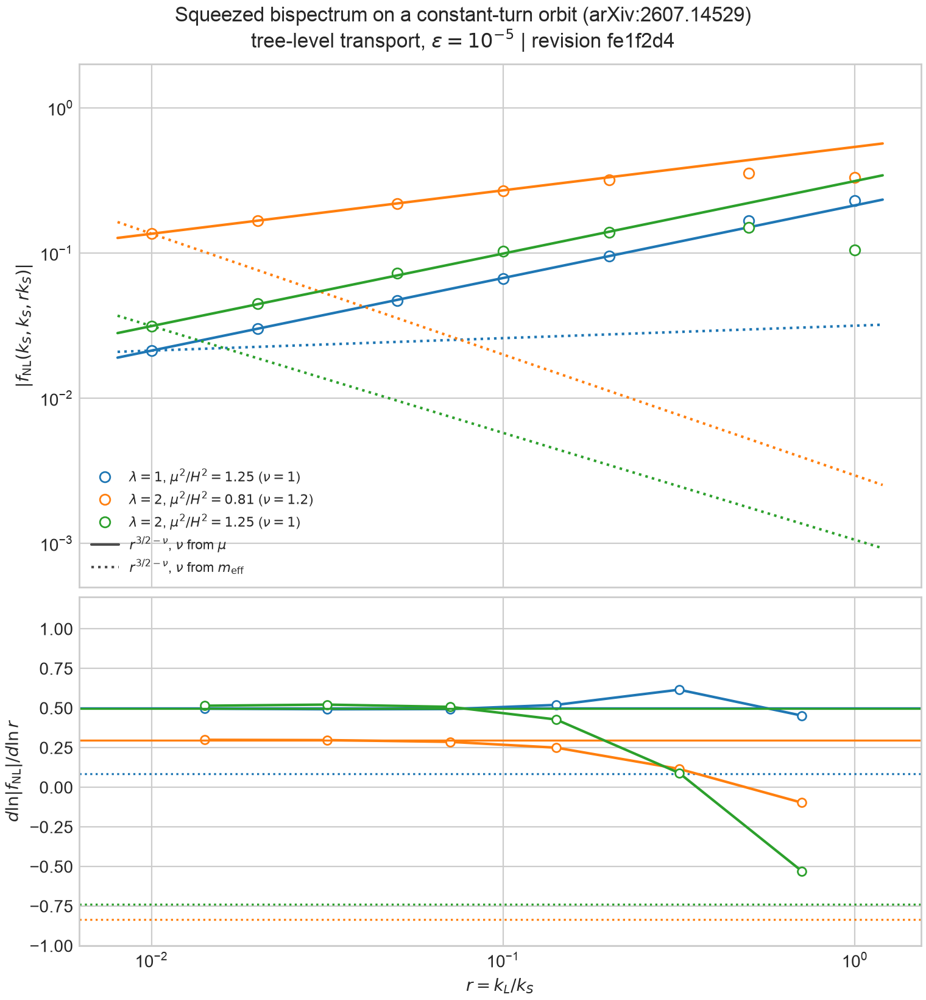

# Exact constant-turn solutions as a mode-solver benchmark

## Purpose

Huenupi, Muñoz, Palma, and Sypsas,
[*Pushing the Primordial Frontier: Exact Linear Solutions in Multifield Inflation*](https://arxiv.org/abs/2606.18248)
(arXiv:2606.18248v2, hereafter [HMPS]), solve the linear two-field system of
constant mixing $\lambda=-2\Omega/H$ and constant entropy mass $\mu$ exactly in
quasi-de Sitter space. Their closed-form $\Delta_\zeta/\Delta_0$ covers the weak and
strong mixing regimes and the massless, light, and heavy entropy fields. The
companion article [arXiv:2607.14529](https://arxiv.org/abs/2607.14529) derives
the tree-level bispectra from the same solutions.

These closed forms test the covariant mode solver in the strongly mixed
regime, where no perturbative expansion in the turn rate is available.
Nothing in the solver is specialized to this background.

## Background

[`PolarFieldSpace`](../src/field_space.rs) is flat field space in polar
coordinates, $ds^2=d\rho^2+\rho^2d\theta^2$. On it the test potential

$$
V=V_0-c\,\theta+\tfrac12 m^2(\rho-\rho_0)^2
$$

has a circular orbit $\rho=R$ with $\dot\theta=\Omega$ when
$c=3HR^2\Omega$ (the angular slow-roll attractor) and $m^2(R-\rho_0)=R\Omega^2$
(radial balance). The orbit's turn rate is $\Omega$, its entropy direction is
$\rho$, and its first slow-roll parameter is $\epsilon=R^2\Omega^2/2H^2=R^2\lambda^2/8$.
The action (1) of [HMPS] writes the $\sigma$ mass as $\mu^2=m_{\mathrm{eff}}^2+\lambda^2H^2$
([arXiv:2607.14529](https://arxiv.org/abs/2607.14529), Eq. (6)), with
$m_{\mathrm{eff}}^2=V_{NN}-\Omega^2+\epsilon H^2\mathbb{R}$. With $V_{NN}=m^2$ and
$\mathbb{R}=0$,

$$
\mu^2=m^2+3\Omega^2 .
$$

The inflaton $\theta$ never stops, so the survey ends on the field-value event
`EndOfInflation::FieldValue` for $\theta$. The mode starts $6$ e-folds before
exit ($z_0=e^6$), and $\Delta_\zeta$ is read $12$ e-folds after exit ($20$ for
$\mu^2=1.25H^2$, whose $\sigma$ decays only as $z^{1/2}$). $\Delta_0=H^2/8\pi^2\epsilon$
uses $H$ and $\epsilon$ at exit. So do the $\lambda=2|\eta_\perp|$ and
$\mu^2=m^2/H^2+3\eta_\perp^2$ inserted in the closed forms; they differ from the
design values by up to $3\times10^{-4}$ relative.

## Massive entropy field

With $\epsilon=10^{-5}$, the mode solver against Eqs. (43)–(45):

| $\lambda$ | $\mu^2/H^2$ | regime | mode solver | closed form | relative difference |
| --- | --- | --- | --- | --- | --- |
| 1 | 1.25 | light, Eq. (43) | 8.85853 | 8.85945 | $-1.0\times10^{-4}$ |
| 2 | 1.25 | light, Eq. (43) | 132.967 | 132.920 | $+3.5\times10^{-4}$ |
| 0.5 | 2 | conformal, Eq. (44) | 1.46503 | 1.46501 | $+1.1\times10^{-5}$ |
| 1 | 2 | conformal, Eq. (44) | 3.67564 | 3.67569 | $-1.5\times10^{-5}$ |
| 2 | 2 | conformal, Eq. (44) | 42.6270 | 42.6247 | $+5.6\times10^{-5}$ |
| 1 | 4 | heavy, Eq. (45) | 1.53052 | 1.53049 | $+2.2\times10^{-5}$ |
| 2 | 4 | heavy, Eq. (45) | 7.51527 | 7.51509 | $+2.4\times10^{-5}$ |
| 1 | 9 | heavy, Eq. (45) | 1.09992 | 1.09989 | $+2.9\times10^{-5}$ |

The remaining difference is the slow-roll correction that [HMPS] neglects. It
is proportional to $\epsilon$ and grows with $\lambda$. For example, at $\lambda=2$
and $\mu^2=1.25H^2$ it is $1.0\%$ for $\epsilon=2\times10^{-4}$ and $0.22\%$ for
$\epsilon=5\times10^{-5}$.

## Massless entropy field

For $\mu=0$, $\sigma$ does not decay and $\zeta$ grows on superhorizon scales. As
printed, Eq. (39) of [HMPS] contains $\ln(2/z_{\mathrm{end}})$. The mode solver, and
an independent integration of Eqs. (8)–(9) of [HMPS]
([`derivations/constant_turn_exact_solutions.py`](derivations/constant_turn_exact_solutions.py)),
agree instead with $\ln(1/2z_{\mathrm{end}})$:

$$
\frac{\Delta_\zeta}{\Delta_0}=\frac{\lambda\sinh\pi\lambda}{\pi(1+\lambda^2)}
\left[2+\ln\frac{1}{2z_{\mathrm{end}}}-2\gamma_E-\operatorname{Re}\psi\!\left(\frac{i\lambda}{2}\right)\right]^2
+\frac{\pi\lambda}{2(1+\lambda^2)}\coth\frac{\pi\lambda}{2}.
$$

This is what Eq. (38) of [HMPS] implies, since its $\mathcal H_w$ contains
$-2\ln(2z)$. At $z_{\mathrm{end}}=4.54\times10^{-5}$:

| $\lambda$ | $\epsilon$ | mode solver | corrected (39) | relative difference | printed (39) |
| --- | --- | --- | --- | --- | --- |
| 0.5 | $3\times10^{-6}$ | 34.2449 | 34.2439 | $2.9\times10^{-5}$ | $+27\%$ |
| 1 | $3\times10^{-6}$ | 202.833 | 202.778 | $2.7\times10^{-4}$ | $+28\%$ |
| 2 | $3\times10^{-7}$ | 3450.47 | 3449.17 | $3.8\times10^{-4}$ | $+29\%$ |

The massless comparison needs the exit values of $\lambda$ and $\mu$ to match
their targets, so the test corrects the orbit parameters three times. Because
the slow-roll correction accumulates over the superhorizon growth, it is
larger here: at $\lambda=2$ it is $3.9\times10^{-3}$ for $\epsilon=3\times10^{-6}$ and
$1.3\times10^{-3}$ for $\epsilon=10^{-6}$. The small-$\lambda$ limit of the corrected form
is $1+\lambda^2(N+2-\ln2-\gamma_E)^2$, with $N=\ln(1/z_{\mathrm{end}})$. This entry is also
recorded in [`literature-discrepancies.md`](literature-discrepancies.md),
entry 10.

## Figure



[`figures/constant_turn_spectra.png`](figures/constant_turn_spectra.png)
([PDF](figures/constant_turn_spectra.pdf)) is generated by

```sh
cargo run --release --example constant_turn_spectra
uv run plots/constant_turn.py diagnostics
```

The left panel is the massive entropy field at $\epsilon=10^{-5}$ for
$\lambda=0.5$, 1, and 2 and $1\le\mu/H\le4$: the curves are Eqs. (43)–(45)
and the markers are the mode solver, read after the light-field tail
$z^{3/2-\nu}$ has decayed. The closed forms are evaluated at the $\lambda$ and
$\mu$ measured at exit, so the lower panel shows only the neglected slow-roll
correction; it stays below $10^{-3}$ and is largest for strong mixing with a
light field ($\lambda=2$, $\mu=H$). The right panel is the massless field at
$z_{\mathrm{end}}=e^{-10}$ and $\epsilon=3\times10^{-7}$, with Eq. (39) both corrected and
as printed. The mode solver follows the corrected form to $8\times10^{-4}$ up to
$\lambda=2.4$, while the printed form is 23–30% high.

## Squeezed bispectrum

The companion article, Huenupi, Muñoz, Palma, and Sypsas,
[*Pushing the Primordial Frontier: Cosmological Collider Signatures at Strong Mixing*](https://arxiv.org/abs/2607.14529)
(arXiv:2607.14529), derives the tree-level bispectra of the cubic
interactions $\sigma(D_t\zeta)^2$, $\sigma^2D_t\zeta$, and $\sigma^3$ with the exact
linear solutions. In the squeezed limit $k_3=rk_S\ll k_1=k_2=k_S$, every
interaction gives the same nonanalytic shape (its Sec. X),

$$
S\simeq c_+\,r^{1/2-\nu}+c_-\,r^{1/2+\nu},\qquad \nu=\sqrt{9/4-\mu^2/H^2},
$$

with $\mu^2=m_{\mathrm{eff}}^2+\lambda^2H^2$, not the effective mass $m_{\mathrm{eff}}$ of the
perturbative decomposition, setting $\nu$. Because $S\propto r^2k_S^6B_\zeta$ and
the reduced bispectrum divides by $2P_\zeta(k_S)P_\zeta(rk_S)\propto r^{-3}$, the
reduced $f_{\mathrm{NL}}\propto rS\propto r^{3/2-\nu}$.

The cubic action of the polar orbit is not of the paper's form: in the
decoupling limit it contains $\sigma(\dot\varphi^2-(\nabla\varphi)^2/a^2)/R$ and
$\Omega\sigma^2\dot\varphi/R$, so the gradient coupling $\sigma(\nabla\varphi)^2$ lies
outside the basis (8) of the paper. The exponent does not depend on the
interaction, so it can be compared directly; the amplitudes $c_\pm$ cannot yet.



[`figures/constant_turn_squeezed.png`](figures/constant_turn_squeezed.png)
([PDF](figures/constant_turn_squeezed.pdf)) is generated, in about nine
minutes, by

```sh
cargo run --release --example constant_turn_squeezed
uv run plots/constant_turn_squeezed.py diagnostics
```

It shows the transport $|f_{\mathrm{NL}}|$ for $\epsilon=10^{-5}$ and $1\ge r\ge0.01$, with
$r^{3/2-\nu}$ drawn for $\nu$ from $\mu$ (solid) and from $m_{\mathrm{eff}}$ (dotted). The
cases avoid exponents near the analytic $r^1$ term:

| $\lambda$ | $\mu^2/H^2$ | $m_{\mathrm{eff}}^2/H^2$ | $3/2-\nu$ from $\mu$ | from $m_{\mathrm{eff}}$ | local slope, $r=0.02$–$0.01$ |
| --- | --- | --- | --- | --- | --- |
| 1 | 1.25 | 0.25 | 0.500 | 0.086 | 0.497 |
| 2 | 1.25 | $-2.75$ | 0.500 | $-0.74$ | 0.515 |
| 2 | 0.81 | $-3.19$ | 0.300 | $-0.83$ | 0.300 |

For $r\lesssim0.05$ the slope settles on the value set by $\mu$, as the paper
states; the $m_{\mathrm{eff}}$ prediction, which would make $|f_{\mathrm{NL}}|$ grow toward
the squeezed limit for $\lambda=2$, is excluded. Near $\nu=1/2$ and $\nu=3/4$ the
leading exponent approaches that of the analytic terms, and the slope
converges only slowly (for $\lambda=2$, $\nu=3/4$ it is 0.28 and 0.61 over
$r=0.03$–$0.01$ and $0.01$–$0.003$), so those cases are not used.

Comparing the amplitudes requires the decoupling-limit cubic action of the
orbit in the paper's variables, including the gradient coupling, and an
independent in-in evaluation; that is the next step.

## Tests

The regular suite runs:

- the `PolarFieldSpace` checks in `src/field_space.rs`: inverse metric,
  Levi-Civita connection and its derivative against finite differences, and
  vanishing curvature built from the connection;
- `closed_form_gamma_and_digamma_match_known_values`, for the complex
  $\ln|\Gamma|$ and $\operatorname{Re}\psi$ helpers used by the closed forms;
- `constant_turn_spectrum_matches_the_exact_massive_solutions`, the table of
  the massive entropy field, to $10^{-3}$;
- `constant_turn_squeezed_bispectrum_scales_with_mu_not_the_effective_mass`
  (ignored, release mode), the slope over $r=0.03$–$0.01$ for the three cases
  above, within 0.03 of the $\mu$ prediction and more than 0.3 from the
  $m_{\mathrm{eff}}$ one;
- `constant_turn_spectrum_fixes_the_logarithm_of_the_massless_solution`, the
  table of the massless entropy field, to $10^{-3}$, which also asserts that
  the printed Eq. (39) is more than 20% high.

## Next steps

1. Amplitudes: derive the decoupling-limit cubic action of the orbit in the
   paper's variables, evaluate it with an independent in-in code built on the
   numerical mode functions of Eqs. (24)–(25), and compare with the transport
   in the equilateral and squeezed limits.
2. Heavy entropy fields, $\mu>3H/2$: the squeezed shape oscillates as
   $r^{1/2}\sin(\rho\ln(1/r)+\phi)$ with $\rho=\sqrt{\mu^2/H^2-9/4}$; resolving a
   period needs $r\lesssim10^{-3}$.
