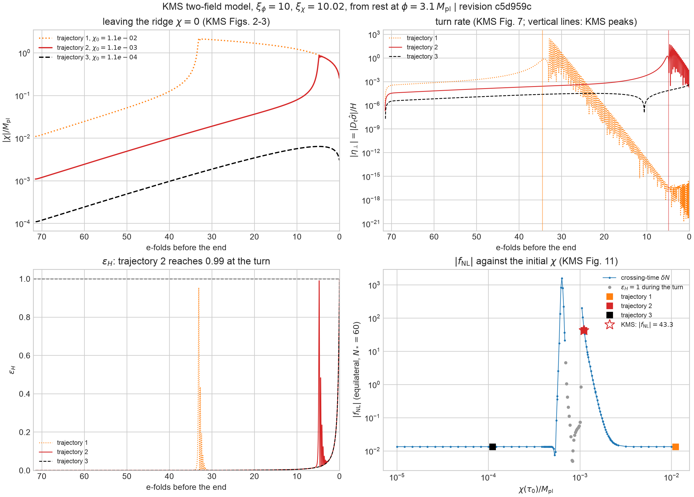

# General nonminimal inflation

Status: G1 and G2 done, with the figure; the crossing-time $\delta N$ of G4 reproduces [KMS]; the transport $f_{\mathrm{NL}}$ of G4 does not converge (see [Results](#results)). This is the P3 item "general nonminimal inflation" of
[`current-status-and-roadmap.md`](current-status-and-roadmap.md).

## Goal

The theory layer already accepts any `GeneralizedNonminimal<N>`: a
conformal factor $\Omega^2(\phi)$, a kinetic matrix $k_{IJ}(\phi)$, and a
Jordan-frame potential, in the metric or the Palatini formulation
([`frames.md`](frames.md)). Two subclasses are validated against the
literature:

| subclass | nonminimally coupled fields | reference | document |
| --- | --- | --- | --- |
| Higgs inflation | one ($N=1$) | arXiv:0710.3755, arXiv:0803.2664 | [`higgs-inflation.md`](higgs-inflation.md) |
| nonminimally assisted inflation | one of two | arXiv:2302.05866 | [`nonminimal-assisted-inflation.md`](nonminimal-assisted-inflation.md) |

In both, $\Omega^2$ depends on a single field, so the Einstein-frame metric
depends on one coordinate and, for $N=2$, its curvature is one function
$K(s)$. Neither tests a field space whose metric depends on all fields, with
a curvature that differs between directions along the trajectory. That is
the generic situation once several fields couple to $R$, and it is where
the curvature terms of the transport (the Riemann tensor in the mass matrix
and its covariant derivative in the cubic tensors) are large.

This step validates the theory layer and the pipeline on that case, with
published numbers, and states what the Palatini counterpart can and cannot be
checked against.

## The reference model

Kaiser, Mazenc, and Sfakianakis,
[*Primordial bispectrum from multifield inflation with nonminimal
couplings*](https://arxiv.org/abs/1210.7487) (arXiv:1210.7487, hereafter
[KMS]): two fields $(\phi,\chi)$ with canonical Jordan-frame kinetic terms,

$$
f(\phi,\chi)=\tfrac12\left[M_{\mathrm{pl}}^2+\xi_\phi\phi^2+\xi_\chi\chi^2\right],
\qquad
\tilde V=\tfrac12m_\phi^2\phi^2+\tfrac12m_\chi^2\chi^2+\tfrac12g\phi^2\chi^2
+\tfrac{\lambda_\phi}4\phi^4+\tfrac{\lambda_\chi}4\chi^4 ,
$$

[KMS] Eqs. (16)–(17). In the notation of [`frames.md`](frames.md),
$\Omega^2=2f/M_{\mathrm{pl}}^2$, $k_{IJ}=\delta_{IJ}$, $V_J=\tilde V$, and the
metric formulation. Both coordinates enter $\Omega^2$, so the Einstein-frame
metric (Kaiser, [arXiv:1003.1159](https://arxiv.org/abs/1003.1159)) is not
diagonal and has no isometry.

The benchmark of [KMS] (Figs. 2–3, 6–11) has $m_\phi=m_\chi=0$,
$\xi_\phi=10$, $\xi_\chi=10.02$, $\lambda_\chi/\lambda_\phi=0.5$,
$g/\lambda_\phi=1$, and $\phi(\tau_0)=3.1\,M_{\mathrm{pl}}$, with three
trajectories

| trajectory | $\chi(\tau_0)/M_{\mathrm{pl}}$ |
| --- | --- |
| 1 | $1.1\times10^{-2}$ |
| 2 | $1.1\times10^{-3}$ |
| 3 | $1.1\times10^{-4}$ |

At large field the Einstein-frame potential tends to
$(M_{\mathrm{pl}}^4/4)(\lambda_\phi\phi^4+2g\phi^2\chi^2+\lambda_\chi\chi^4)/(\xi_\phi\phi^2+\xi_\chi\chi^2)^2$,
which is larger on the $\phi$ axis ($\lambda_\phi/\xi_\phi^2$) than on the
$\chi$ axis ($\lambda_\chi/\xi_\chi^2$): $\chi=0$ is a ridge. The three
trajectories start on it at different distances, fall off it at different
times, and turn into the $\chi$ valley. $\lambda_\phi$ sets only the
amplitude ([KMS] use $\tau=\sqrt{\lambda_\phi}M_{\mathrm{pl}}t$), so the
shape-level observables below are independent of it.

### Published numbers

| quantity | trajectory 1 | trajectory 2 | trajectory 3 | where |
| --- | --- | --- | --- | --- |
| total e-folds | | 71.5 | | Fig. 3 |
| e-folds before the end at the turn-rate peak | 34.5 | 4.9 | | Fig. 7 |
| $T_{\mathcal{RS}}(N_{40})$ | 0.530 | 0.011 | 0.001 | Sec. IV |
| $n_s$ at $N_*=60$ | 0.967 | 0.967 | 0.967 | Sec. IV |
| $\lvert f_{\mathrm{NL}}\rvert$ at $N_*=60$ | negligible | 43.3 | negligible | Sec. V, Fig. 11 |

The end of inflation is $\ddot a=0$ ($\epsilon_H=1$), and e-folds and $\zeta$
are Einstein-frame quantities ([KMS] Sec. II), so
`EndOfInflation::SlowRollViolation` and the reported $\zeta$ correspond
directly. The full text (TeX source of the arXiv version) settles the rest
as follows.

- **Initial velocities** are not stated for trajectories 1–3 (only for the
  potential-free geodesic of Fig. 1). The runs here start from the slow-roll
  velocity at $\tau_0$, and the dependence of the observables on that choice
  is reported.
- **$N_{40}$** is not defined. The text says $T_{\mathcal{RS}}$ "remains small
  between $N_*=60$ and 40", so $T_{\mathcal{RS}}(N_{40})$ is read as the transfer
  from horizon crossing at $N_*=60$ to 40 e-folds before the end.
- **$f_{\mathrm{NL}}$** is plotted as $|f_{\mathrm{NL}}|$ (Fig. 11), so only the
  magnitude is compared; the sign is reported in the convention of
  [`curvature-projection.md`](curvature-projection.md).
- **The total e-folds** count from $\tau_0$: the fields fall off the ridge at
  $N=66.6$ and inflate 4.9 more e-folds, giving 71.5 (Fig. 3).

### What the published $f_{\mathrm{NL}}$ is

[KMS] compute $f_{\mathrm{NL}}$ with covariant $\delta N$ (Eq. 92) in the
equilateral configuration: $N$ from re-solving the background to
$\epsilon_H=1$, central differences in the field values at horizon crossing,
velocities fixed by slow roll, and the Riemann terms of Eqs. (93)–(105)
dropped as $O(\epsilon)$. Two things therefore separate it from the
transport:

- **Slow-roll velocities at crossing.** The assisted validation found the
  crossing-time $\delta N$ low by 8–20% where the isocurvature direction is
  tachyonic ([`nonminimal-assisted-inflation.md`](nonminimal-assisted-inflation.md)).
  A ridge is tachyonic by construction.
- **Sensitivity to initial conditions.** [KMS] report that a change of
  $10^{-3}$ in $\chi(\tau_0)$ changes the evolution substantially. Trajectory 2
  sits where $f_{\mathrm{NL}}$ is largest and steepest in $\chi(\tau_0)$.

The internal comparison (transport against phase-space $\delta N$ from the
proper-time velocity, which agree to about $10^{-4}$ in the assisted model) is
therefore the sharp test; the comparison with 43.3 is a reproduction within
the stated approximation, with the gap attributed term by term, not a
tolerance chosen to pass.

## Steps

| step | content | acceptance |
| --- | --- | --- |
| G1 (done) | `phys_type_models::kms::KmsTheory` as a `GeneralizedNonminimal<2>`; closed-form Einstein-frame metric ([KMS] Eq. 110) and Gaussian curvature as test oracles | `einstein_frame` reproduces the metric to $10^{-13}$, the Riemann tensor to $10^{-10}$, and $\nabla R$ to the finite-difference error, metric and Palatini. [KMS] Eq. (115) prints twice the Ricci scalar ([`literature-discrepancies.md`](literature-discrepancies.md) entry 14) |
| G2 (done) | background of the three trajectories | total e-folds and turn-rate peaks of the table; the tracked figure `figures/kms_trajectories.png` (Figs. 2–3, 7, and 11) |
| G3 | spectra at $N_*=60$ | $n_s$ to the precision printed; $T_{\mathcal{RS}}$ once $N_{40}$ is fixed |
| G4 | equilateral $f_{\mathrm{NL}}$ at $N_*=60$ | transport against phase-space $\delta N$ to $\lesssim10^{-3}$ for all three; trajectory 2 against 43.3 with the slow-roll-velocity and Riemann-term differences quantified; scan of $f_{\mathrm{NL}}$ against $\chi(\tau_0)$ around trajectory 2 (Fig. 11) |
| G5 | the Palatini counterpart (below) | consistency checks only |
| G6 | the Jordan-frame $\zeta$ (below) | separate design; not part of this step |

## Results

The tests are `crates/phys-type-models/tests/kms.rs` (G1) and
`tests/kms_trajectories.rs` (G2, G4; ignored, release mode).

**Background (G2).** Starting from rest, trajectory 2 inflates for 71.517
e-folds, against 71.5 in Fig. 3; the slow-roll initial velocity gives 71.19,
so [KMS] evidently start from rest. As the fields fall off the ridge the turn
rate has a first maximum, $|\eta_\perp|\simeq0.8$ and 1.7, 34.06 (trajectory 1)
and 5.15 (trajectory 2) e-folds before the end, against 34.5 and 4.9 in
Fig. 7; the spacing of the two is 28.9 e-folds here and 29.6 in [KMS]. The
heavy oscillation of $\phi$ in the $\chi$ valley afterwards drives
$|\eta_\perp|$ to $10^2$–$10^3$ in spikes, which are not the peaks of Fig. 7.
Trajectory 3 stays on the ridge until inflation ends.

**Trajectory 2 nearly stops inflating.** At the turn, $\epsilon_H$ reaches
0.990 on trajectory 2 (0.954 on trajectory 1). For $6.9\times10^{-4}\lesssim
\chi(\tau_0)\lesssim1.0\times10^{-3}$ it reaches one, the survey ends at that
first crossing with $\chi\simeq0.5$–$0.8$ (inflation would resume in the
valley), and the total falls to 67.8–71.4 e-folds. The large $|f_{\mathrm{NL}}|$
of [KMS] sits on the edge of that window: the crossing-time $\delta N$ rises
to $+2\times10^2$ at $\chi(\tau_0)=1.05\times10^{-3}$ and $-1.6\times10^3$ at
$6.3\times10^{-4}$, on either side of it. The "dramatic changes" with the
initial conditions that [KMS] report are this proximity to an interruption
of inflation, which also makes the result depend on how the end of
inflation is defined.



[`figures/kms_trajectories.png`](figures/kms_trajectories.png)
([PDF](figures/kms_trajectories.pdf)) is generated, in about half a minute,
by

```sh
cargo run --release --example kms_trajectories
uv run plots/kms_trajectories.py diagnostics
```

**Crossing-time $\delta N$ (G4, the method of [KMS]).** With the field
derivatives of $N$ at the crossing of the pivot and slow-roll velocities,
$|f_{\mathrm{NL}}|=43.38$ for trajectory 2 (43.3 in [KMS]) and 0.013 for
trajectories 1 and 3, stable to $10^{-3}$ in the step size. In the
convention of this repository the sign is positive; [KMS] Eq. (92) carries
the opposite sign. Its $P_\zeta$ is 5% below the exact mode solver at the
end, the size expected from the slow-roll velocities.

**Transport $f_{\mathrm{NL}}$ (G4, open).** The tree-level transport does not
converge for trajectory 2. At the end of inflation its $P_\zeta$ agrees with
the mode solver only for a relative tolerance of $10^{-11}$ or below, and its
$f_{\mathrm{NL}}$ scales with the tolerance: $-6\times10^4$, $-6\times10^3$,
and $-670$ at $10^{-11}$, $10^{-12}$, and $10^{-13}$, dominated entirely by the
intrinsic term $N_aN_bN_c\alpha^{abc}$. The background tolerance and the
start depth do not change it. $P_\zeta$ itself rises to $5\times10^5$ times
its final value during the turn and then cancels to $7.2\times10^{-4}$ once
the isocurvature mode decays, so the final three-point function is a small
remainder of large intermediate correlators. The steps that follow are to
locate the loss of precision (the sharp turn, $\eta_\perp\simeq50$, or the
heavy oscillation of $\phi$ in the valley afterwards) and to evaluate the
transport in a better-conditioned basis or to end it on a slice where the
remainder is not yet small. Until then the transport is not validated on
this model, and phase-space $\delta N$ is the reference for G4.

Discrepancies with [KMS] go to
[`literature-discrepancies.md`](literature-discrepancies.md), as before.

## The Palatini counterpart

With $\kappa=0$ the same $f(\phi,\chi)$ gives
$G_{IJ}=\delta_{IJ}/\Omega^2$, a conformally flat metric. No published
multi-field Palatini result was found that is as specific as [KMS]; until one
is, G5 checks only structure:

- the Gaussian curvature of $\delta_{IJ}/\Omega^2$ in closed form, against the
  autodiff Riemann tensor and its derivative;
- at $\xi_\chi=0$, $\chi$ a light spectator: $n_s$ and $r$ of the $\phi$
  direction equal the one-field Palatini Higgs results of
  [`higgs-inflation.md`](higgs-inflation.md) with $V_J\to\lambda_\phi\phi^4/4$;
- the metric–Palatini difference in $f_{\mathrm{NL}}$ on trajectory 2, reported
  as a prediction, not a validation.

A literature search for a multi-field Palatini reference with numbers is part
of G5; the affine-inflation analysis of
[arXiv:2111.03828](https://arxiv.org/abs/2111.03828) is the first candidate to
check for whether its formulation coincides with $\kappa=0$.

## Out of scope

- **The Jordan-frame $\zeta$.** For several fields it differs from the
  Einstein-frame $\zeta$ while isocurvature persists
  ([`frames.md`](frames.md)); [KMS] report Einstein-frame quantities, so this
  step does not need it. It remains an open question of
  [`architecture.md`](architecture.md).
- **Couplings beyond $f(\phi)R$.** Derivative couplings (Horndeski, DHOST) and
  non-metricity beyond $\kappa=0$ are outside the theory class.
- **Isocurvature at late times** (Schutz, Sfakianakis, and Kaiser,
  [arXiv:1310.8285](https://arxiv.org/abs/1310.8285)) needs the evolution after
  inflation, which is the separate reheating item.
