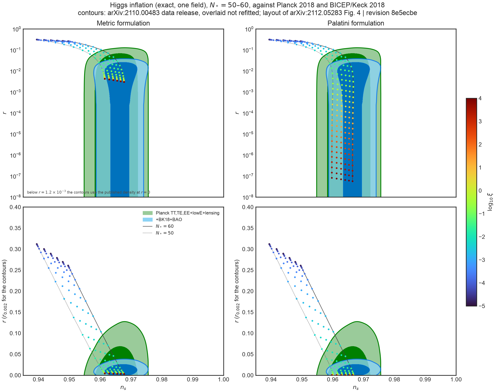

# Higgs inflation

The first single-field target of the $N$-field pipeline
([`n-field-perturbations.md`](n-field-perturbations.md)), stated through the
theory layer: $\Omega^2=1+\xi\phi^2$, a canonical Jordan-frame kinetic term, and
$V_J=\lambda\phi^4/4$ ([Bezrukov and Shaposhnikov,
arXiv:0710.3755](https://arxiv.org/abs/0710.3755)), in the metric and the
Palatini formulation ([Bauer and Demir,
arXiv:0803.2664](https://arxiv.org/abs/0803.2664)). The model is
`phys_type_models::higgs::HiggsTheory`; `phys_type::einstein_frame` gives
the one-field Einstein-frame system, and nothing in the engine is specific to
it.

## What is computed

The pivot leaves the horizon 60 Einstein-frame e-folds before $\epsilon_H=1$;
the spectra are read one e-fold before the end. $n_s$ is the logarithmic
derivative of the exact $\mathcal P_{\mathcal R}$ over $k e^{\pm0.02}$, and
$r=\mathcal P_t/\mathcal P_{\mathcal R}$ with the tensor mode of the same
wavenumber. $\lambda$ only sets the amplitude. The comparison values are
first-order slow roll from the same Einstein-frame potential and metric,
$\epsilon_V=\tfrac12(\partial_\chi\ln V)^2$ and $\eta_V=V_{,\chi\chi}/V$ with
$d\chi=\sqrt G\,d\phi$, and the large-$\xi$ limits.


[`figures/higgs_inflation.png`](figures/higgs_inflation.png)
([PDF](figures/higgs_inflation.pdf)) is generated, in a few seconds, by

```sh
cargo run --release --example higgs_inflation
uv run plots/higgs_inflation.py diagnostics
```

## Results

At $\xi=10^4$:

| | exact | first-order slow roll | large-$\xi$ limit |
| --- | --- | --- | --- |
| metric $n_s$ | 0.96775 | 0.96783 | $1-2/N=0.96667$ |
| metric $r$ | $3.007\times10^{-3}$ | $2.964\times10^{-3}$ | $12/N^2=3.33\times10^{-3}$ |
| Palatini $n_s$ | 0.96643 | 0.96667 | $1-2/N=0.96667$ |
| Palatini $r$ | $5.70\times10^{-8}$ | $5.55\times10^{-8}$ | $2/(\xi N^2)=5.56\times10^{-8}$ |

- The exact $n_s$ follows first-order slow roll to $2.5\times10^{-4}$ for
  $\xi\ge10^{-2}$ and to $9\times10^{-4}$ near quartic inflation ($\xi=10^{-3}$,
  where $\epsilon$ is larger); $r$ follows it to 3%. These are the sizes of
  second-order slow-roll terms.
- The metric $r$ sits about 10% below $12/N^2$ at $N=60$, an $O(1/N)$
  correction of the large-$\xi$ limit (effectively a shift of $N$ by a few);
  $n_s$ is $1.1\times10^{-3}$ above $1-2/N$ for the same reason.
- In the Palatini formulation $\xi r$ is constant to 1% between $\xi=10^3$ and
  $10^4$, as $r\propto1/\xi$ requires.
- **E-folds in the two frames.** The same interval, 60 e-folds in the Einstein
  frame, spans $N_J-N_E\simeq2$ more Jordan-frame e-folds in the metric
  formulation at large $\xi$ and up to about 7 more in the Palatini
  formulation at $\xi=10^4$, where $\Omega$ changes far more between the pivot
  and the end. $n_s$ at a physical scale is frame invariant
  ([`frames.md`](frames.md)), but "$N_*=60$" in a paper must be read in the
  frame it was counted in; for Palatini Higgs inflation the choice moves $n_s$
  by about $2\Delta N/N^2\simeq4\times10^{-3}$.

## The $n_s$–$r$ plane

`examples/higgs_ns_r.rs` runs the same exact evolution
(`examples/shared/higgs.rs`) on a grid of $\log_{10}\xi=-5,-4.75,\dots,4$ and
$N_*=50,52,\dots,60$ Einstein-frame e-folds before the end, in both
formulations (444 points, about a minute). `plots/higgs_ns_r.py` follows the
layout of Fig. 4 of Kodama and Takahashi,
[arXiv:2112.05283](https://arxiv.org/abs/2112.05283): metric and Palatini in
two columns, logarithmic and linear $r$ in two rows, $\log_{10}\xi$ as colour.
It overlays the points on
the 68% and 95% contours that BICEP/Keck publish with
[BICEP/Keck XIII, arXiv:2110.00483](https://arxiv.org/abs/2110.00483)
(Fig. 5, data release `rns_code.tgz` at
<http://bicepkeck.org/>), for "Planck TT,TE,EE+lowE+lensing" and
"+BK18+BAO". `scripts/fetch_bk18.py` downloads that release into
`data/bk18_rns/` and checks its SHA-256; the contours are not redistributed in
this repository.



| $N_*$ | metric, $\xi=10^4$ | Palatini, $\xi=10^4$ |
| --- | --- | --- |
| 50 | $n_s=0.96150$, $r=4.25\times10^{-3}$ | $n_s=0.95971$, $r=8.2\times10^{-8}$ |
| 60 | $n_s=0.96775$, $r=3.01\times10^{-3}$ | $n_s=0.96643$, $r=5.7\times10^{-8}$ |

The smallest $\log_{10}\xi$ on the grid that lies inside each region
(every larger $\xi$ on the grid stays inside; identical for the two
formulations at this resolution):

| region | $N_*=50$ | $N_*=60$ |
| --- | --- | --- |
| Planck 95% | $-1.75$ | $-2.25$ |
| Planck 68% | $-1.25$ | $-2.0$ |
| +BK18+BAO 95% | $-1.25$ | $-1.75$ |
| +BK18+BAO 68% | none | $-1.5$ |

- At $\xi=10^{-5}$ both formulations are quartic inflation
  ($r\simeq0.26$–0.31), well outside both regions. They separate only once
  $\xi\gtrsim10^{-2}$, where $\xi\phi_*^2\sim1$.
- The two formulations separate only in $r$: at large $\xi$ the metric $r$
  saturates at $\simeq12/N^2$, while the Palatini $r\propto1/\xi$ falls below any
  foreseeable sensitivity; $n_s$ differs by $\lesssim2\times10^{-3}$.
- The region table comes from interpolating the published densities at each
  point. It is a reading of the overlay, not a likelihood.
- **This is an overlay, not a fit.** The contours are the published
  $\Lambda$CDM+$r$ posteriors and are not recomputed for this model; see
  [`planck-2018-likelihood-boundary.md`](planck-2018-likelihood-boundary.md).
- **Pivot.** The contours use $r_{0.002}$ ($k=0.002\,\mathrm{Mpc}^{-1}$); the
  Higgs points give $r$ at the mode that crosses the horizon $N_*$ e-folds
  before the end. Mapping $N_*$ onto a physical $k$ needs the reheating
  history, which is not modelled. That uncertainty is the reason for showing
  both 50 and 60. Within it, the difference between $r_{0.002}$ and $r_{0.05}$
  (under 1% for these models) is negligible.
- **Frame.** $N_*$ is counted in the Einstein frame; the Jordan-frame counts
  for the same interval are in the `jordan_e_folds` column (see above).

## Tests

`crates/phys-type-models/tests/higgs.rs` (ignored, release mode): the exact
$n_s$ and $r$ against first-order slow roll for $\xi=10^{-2}$, 1, and $10^3$ in
both formulations, and the large-$\xi$ limits. The slow-roll functions are
checked against quartic inflation at $\xi=0$ and the large-$\xi$ limits in the
crate's unit tests.
