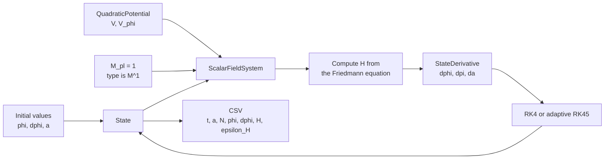

# phys-type MVP design

## Goal

The first goal is a tool that can be used in the author's own inflationary
cosmology calculations. General-purpose library design comes later.

The MVP demonstrates that a single-field inflation background can be
integrated while dimensionally invalid expressions fail at compile time.

## Scope

- Stable Rust only.
- Natural units with `c = hbar = 1`.
- Physical dimensions are represented as powers of mass.
- Mass exponents support half-integer steps, such as `M^(1/2)`.
- `typenum` performs the internal type-level integer arithmetic.
- Numerical calculations initially use `f64`.
- The core representation remains generic over its stored value. The `Dual`
  automatic-differentiation type is one such value representation.
- A small, fixed-step RK4 implementation establishes the numerical baseline.
- Post-MVP extensions add first-order automatic differentiation, adaptive
  Dormand-Prince 5(4), and fixed-size canonical multifield backgrounds.

## Core quantity

```rust
Quantity<Dimension, Value>
```

`Dimension` describes the physical dimension at compile time. `Value` is the
stored numerical representation. The core type remains responsible only for
"a numerical value with a physical dimension". Units, tensor indices, and
coordinate systems should be separate abstractions.

The initial implementation uses `f64`, for example:

```rust
Quantity<M1, f64>
```

The internal encoding counts half-powers of mass:

```text
internal 1 -> M^(1/2)
internal 2 -> M^1
internal 4 -> M^2
```

This supports operations needed later in perturbation calculations:

```text
sqrt(M^1)             -> M^(1/2)
M^(1/2) * M^(1/2)     -> M^1
```

Quarter powers and general rational powers are not initially supported. They
will be added only if the target calculations require them.

## Arithmetic rules

```text
M^a + M^a -> M^a
M^a - M^a -> M^a
M^a + M^b -> compile error when a != b
M^a * M^b -> M^(a+b)
M^a / M^b -> M^(a-b)
```

Raw `f64` values may multiply or divide a quantity as dimensionless numerical
coefficients. A dimensionless physical quantity is still represented as
`Quantity<M0, f64>` rather than as a raw `f64`.

Square root is a core dimension operation. It is available when the resulting
mass exponent can be represented by the supported half-integer grid.

Semantic aliases make scientific code readable:

```rust
type Field = Quantity<M1, f64>;
type FieldVelocity = Quantity<M2, f64>;
type Hubble = Quantity<M1, f64>;
type EnergyDensity = Quantity<M4, f64>;
type Time = Quantity<MMinus1, f64>;
```

Aliases with equal dimensions remain the same physical type. The MVP detects
dimension errors, but does not distinguish two different concepts that happen
to have the same dimension.

## Explicit dimension boundaries

Raw inputs receive dimensions explicitly:

```rust
let phi = Field::new(0.17);
```

Raw values are extracted explicitly for output and interoperability:

```rust
let raw: f64 = phi.into_value();
```

Dimension information must not disappear through an implicit conversion.

## Background state

The independent variable in the MVP is cosmic time `t`, with mass dimension
`M^-1`.

```rust
struct State {
    phi: Field,
    pi: FieldVelocity,
    a: ScaleFactor,
}
```

Here `pi = dphi/dt` and the scale factor `a` is dimensionless.

The time derivative is a physically different type:

```rust
struct StateDerivative {
    dphi_dt: Quantity<M2, f64>,
    dpi_dt: Quantity<M3, f64>,
    da_dt: Quantity<M1, f64>,
}
```

A time step converts a derivative into a state-sized change:

```text
Time * StateDerivative -> StateDelta
State + StateDelta     -> State
```

The intermediate type is named `StateDelta`.

The canonical multifield implementation groups equal-dimension values in
const-generic arrays:

```rust
struct MultifieldState<const N: usize> {
    phi: [Field; N],
    pi: [FieldVelocity; N],
    a: ScaleFactor,
}
```

This first version assumes a flat field-space metric and canonical kinetic
terms. The staged design for tensor variance, covariant backgrounds, and
two-field perturbations is specified in
[`two-field-perturbation-design.md`](two-field-perturbation-design.md).
Dynamically sized tensors remain a separate future extension.

## Potential

A potential formula is evaluated through a numerical value type `V`:

```rust
trait PotentialValue<V> {
    fn value(&self, phi: Field<V>) -> Quantity<M4, V>;
}

trait Potential: PotentialValue<f64> + PotentialValue<Dual> {
    fn gradient(&self, phi: Field) -> Quantity<M3, f64> {
        // Evaluate V with d(phi)/d(phi) = 1 and return the derivative part.
    }
}
```

`PotentialValue<V>` contains the formula and is not intrinsically tied to
`f64`. The same formula is evaluated with the first-order forward-mode `Dual`
type to obtain the gradient. Model parameters such as masses and couplings
remain fixed; the field is the differentiation variable. The multifield
interface evaluates the formula once per active `phi^I` to obtain every
gradient component.

The MVP implements a quadratic potential:

```text
V(phi) = (1/2) m^2 phi^2
```

The gradient is not written separately from the potential formula. `Potential`
has a default `gradient` implementation and is automatically implemented for
types supporting both ordinary and dual-number evaluation. Higher derivatives
can later use a value type capable of carrying the required derivative order,
without adding one handwritten method per order to each potential.

## Scalar-field system

The concrete physical system stores a potential and the reduced Planck mass:

```rust
struct ScalarFieldSystem<P> {
    potential: P,
    m_pl: Quantity<M1, f64>,
}
```

`M_pl` has numerical value `1.0` in Planck units but retains mass dimension
`M^1` in the type system.

The system evolves

```text
dphi/dt = pi
dpi/dt = -3 H pi - V_phi
da/dt = a H
```

`H` is not an independently integrated state variable. At every right-hand-side
evaluation, the expanding branch is computed from the current state:

```text
H = +sqrt(((1/2) pi^2 + V(phi)) / (3 M_pl^2))
```

The generic integration layer only requires the ability to calculate a state
derivative. It provides fixed-step RK4 and an embedded Dormand-Prince 5(4)
estimate. Knowledge of potentials, Friedmann dynamics, and component-specific
error scales belongs to the concrete scalar-field system, not to the generic
integrator.

The integrator receives both the current independent-variable value and the
step size. The MVP uses cosmic time, while a later system may use a
dimensionless e-folding variable. States and derivatives need to be `Clone`,
but not `Copy`; the const-generic array-backed multifield state uses this same
integrator interface directly.



## Initial values and termination

The user supplies `phi`, `dphi`, and `a`. The example initializes `dphi` using
the slow-roll estimate:

```text
dphi/dt ~= -V_phi / (3 H)
```

The e-folding number is derived rather than independently integrated:

```text
N = ln(a / a_initial)
```

Integration stops at the first of:

- `N = 60`, or
- `epsilon_H >= 1`, where

```text
epsilon_H = pi^2 / (2 M_pl^2 H^2)
```

## Output

The core library does not implement plotting. It writes CSV as a stable
boundary between the Rust calculation and external analysis:

```text
t,a,e_folds,phi,dphi,H,epsilon_h
```

The stored types remain dimensionful, while exported raw values use Planck
units:

```text
t       = t M_pl
a       = a
e_folds = ln(a/a_initial)
phi     = phi/M_pl
dphi    = (dphi/dt)/M_pl^2
H       = H/M_pl
```

The first visualization is a four-panel background overview made with Python,
NumPy, and Matplotlib. Python dependencies are isolated from the Rust crate and
managed by `uv`. The detailed design is recorded in
[`visualization-design.md`](visualization-design.md).

## MVP success criteria

1. The quadratic single-field background reaches the requested termination
   condition using fixed-step RK4 or adaptive Dormand-Prince 5(4).
2. Results can be exported as CSV and plotted externally with the documented
   Python and Matplotlib workflow.
3. A deliberately invalid expression with mismatched dimensions fails to
   compile.
4. Compile-fail tests preserve this behavior as part of the library contract.
