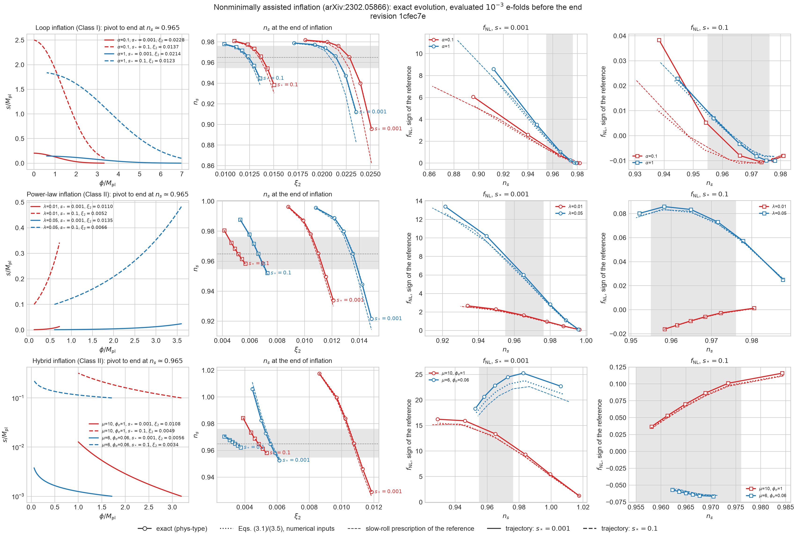

# Nonminimally assisted inflation

## Purpose

This is the first external model validation after the non-Gaussianity
milestone. The target is Hyun, Kim, Kodama, Park, and Takahashi,
[*Nonminimally Assisted Inflation: A General Analysis*](https://arxiv.org/abs/2302.05866)
(arXiv:2302.05866v2, hereafter [HKKPT]), and within it the loop-inflation
example of Class I (Sec. 4.1) and the Class II power-law and hybrid examples
(Secs. 4.2 and 4.3). The contract from the roadmap is that the
Einstein-frame metric and potential enter as ordinary `FieldSpaceGeometry` and
potential providers, with no special case in the solvers. The dimension,
index-variance, Riemann-identity, and covariance checks must all stay active.

[HKKPT] predicts $n_s$, $r$, and $f^{\mathrm{local}}_{\mathrm{NL}}$ from slow-roll
$\delta N$ expressions, Eqs. (3.1), (3.2), and (3.5). This repository evolves the
same model exactly: the full background, the linear modes, and the tree-level
bispectrum, with no slow-roll approximation after the initial conditions. It
then compares with those expressions.

**Scope.** Nonminimally assisted inflation is one small class of nonminimal
inflation: a single assistant field with $f(s)=(M_{\mathrm{pl}}^2/2)(1+\xi_2s^2)$
and a minimally coupled inflaton, in the metric formulation ($\kappa=1$; the
Palatini $\kappa=0$ geometry exists but is not validated). Nothing here
validates nonminimal inflation in general, for example an inflaton coupled to
curvature as in Higgs inflation, a general $f(\phi,s)$, several nonminimal
fields, or the Palatini predictions. Since step 4a of
[`architecture.md`](architecture.md) the model is an instance of the general
theory layer, `phys_type_models::assisted::AssistedTheory`, in the
`phys-type-models` crate, and the reference's formulas are
`phys_type_models::hkkpt`; the core contains no assisted-specific code.

## Model

With $f(s)=\tfrac{M_{\mathrm{Pl}}^2}{2}[1+\xi_2(s/M_{\mathrm{Pl}})^2]$ (Eq. (2.5)),
the Einstein frame has, in the coordinates $(\phi,s)$ (Eqs. (2.6)--(2.9)),

$$
G=\operatorname{diag}(\mathcal K_1,\mathcal K_2),\qquad
\mathcal K_1=\frac{1}{1+\xi_2s^2},\qquad
\mathcal K_2=\mathcal K_1+6\kappa\xi_2^2s^2\mathcal K_1^2,\qquad
V=\frac{V_J(\phi)}{(1+\xi_2s^2)^2},
$$

in reduced Planck units, with $\kappa=1$ (metric) or $0$ (Palatini).
`AssistedTheory` states only $\Omega^2=1+\xi_2s^2$, canonical Jordan kinetic terms,
and $V_J$, for example $V_J=\Lambda^4(1+\alpha\ln\phi)$ (Eq. (4.1)), and
`phys_type::einstein_frame` derives this geometry and potential by automatic
differentiation. The original hand-written geometry and potentials remain as
test fixtures of the core (`crates/phys-type/src/test_models/`), where the
generic map is checked against them to $10^{-12}$.

Neither field is canonically normalized, so the geometry supplies every
connection and curvature term. Since the metric depends only on $s$ in two
dimensions, the curvature is set by the Gaussian curvature

$$
K=\frac{\mathcal K_1\mathcal K_1'\mathcal K_2'-2\mathcal K_1\mathcal K_1''\mathcal K_2
+\mathcal K_1'^2\mathcal K_2}{4\mathcal K_1^2\mathcal K_2^2},\qquad
R^I{}_{JKL}=K(\delta^I_KG_{JL}-\delta^I_LG_{JK}),
$$

and $\nabla_MR^I{}_{JKL}=(\partial_MK)(\delta^I_KG_{JL}-\delta^I_LG_{JK})$. The
derivatives of $\mathcal K_{1,2}$ to third order come from `ThirdOrderJet`.
The $K$ formula reproduces $K=-1$ for the hyperbolic metric. Unit tests check
each piece against an independent finite-difference construction:

- the Christoffel symbols against the Levi-Civita connection of the
  finite-differenced metric;
- $\partial\Gamma$ against differenced Christoffel symbols;
- the Riemann tensor against $\partial\Gamma+\Gamma\Gamma$ in the crate
  convention, where the same formula is first shown to reproduce the built-in
  hyperbolic geometry;
- the Riemann symmetries through `validate_riemann_symmetries`;
- $\nabla R$ against the covariant finite difference of $R$;
- the potential and its automatic-differentiation gradient against the
  closed form.

## Configuration

All results use the reference example $\alpha=0.1$, $s_*=10^{-3}$, $\kappa=1$,
and $\Lambda^4=10^{-10}$; $\Lambda$ does not affect $n_s$ or $f_{\mathrm{NL}}$. The
pivot leaves the horizon 60 e-folds before $\epsilon_H=1$. The initial $s$ is
tuned so that $s=s_*$ at the pivot. Linear modes and the three-point transport
start 5 e-folds before exit.

**Evaluate at the end of inflation.** The assistant field keeps rolling, so
$\zeta$ is not conserved on superhorizon scales before inflation ends. For
$\xi_2=0.022$:

| E-folds before $\epsilon_H=1$ | 10 | 5 | 2 | 1 | 0.5 | 0.1 | 0.01 |
| --- | --- | --- | --- | --- | --- | --- | --- |
| $n_s$ from the mode solver | 0.847 | 0.843 | 0.859 | 0.888 | 0.924 | 0.964 | 0.973 |

[HKKPT] evaluates the observables at the end of inflation. All comparisons
below therefore use a slice $10^{-3}$ e-folds before $\epsilon_H=1$. No
post-inflationary evolution is included.

## Spectral index

Three independent determinations agree at $\xi_2=0.022$:

| Method | $n_s$ |
| --- | --- |
| mode solver, $d\ln\mathcal P_{\mathcal R}/d\ln k$ | 0.97408 |
| numerical $\delta N$ from the horizon-crossing slice, massless crossing statistics | 0.97470 |
| [HKKPT] Eq. (3.1) with the numerical $\phi_*$, $s_*$, and $s_e$ | 0.97391 |

Eq. (3.1) follows the exact tilt across the coupling range, even though $n_s$
itself moves by 0.08:

| $\xi_2$ | 0.021 | 0.022 | 0.023 | 0.0235 | 0.024 | 0.025 |
| --- | --- | --- | --- | --- | --- | --- |
| numerical $n_s$ | 0.9789 | 0.9741 | 0.9626 | 0.9525 | 0.9387 | 0.9001 |
| Eq. (3.1) with numerical $s_e$ | 0.9786 | 0.9739 | 0.9627 | 0.9528 | 0.9391 | 0.9003 |
| Eq. (3.1) with $s_e$ from Eq. (3.9), $N_e=60$ | 0.977 | 0.969 | 0.950 | | | |
| numerical $s_e$ | 0.135 | 0.169 | 0.212 | 0.238 | 0.266 | 0.334 |

The last two rows explain the only difference from the published curves.
[HKKPT] obtains $s_e$ from the slow-roll e-fold relation, Eq. (3.9) or its
approximation (3.12). Inserting the numerical $s_*$ and $s_e$ into Eq. (3.9)
gives 58.3 e-folds instead of 60. The difference is not the choice of end
condition: on the numerical trajectory, $\epsilon^{(0)}=1$ ($\phi=0.093$) is
passed only about 0.1 e-fold before $\epsilon_H=1$. The 1.7 e-folds instead
accumulate over the whole trajectory. They are 3% of the e-fold count, of the
size expected from next-order slow-roll corrections to the $s(N)$ relation
when $\eta^{\sigma\sigma}\approx-4\xi_2$. Because $s_e\propto e^{4\xi_2N}$, the
difference shifts $s_e$ by 16% and moves $n_s$ noticeably. The numerical
$n_s=0.965$ occurs at $\xi_2\approx0.0228$, whereas the published prescription
gives $\xi_2\approx0.0222$. This is a shift of about 3% within
the range the reference quotes; the conclusion that a small nonminimal
coupling rescues loop inflation is unchanged.

## Non-Gaussianity

At $\xi_2=0.022$, with $f_{\mathrm{NL}}$ in the Maldacena/Planck sign convention
of this repository:

| Method | $f_{\mathrm{NL}}$ |
| --- | --- |
| tree-level transport, equilateral, start depths 4--7 | $-0.25141$ (stable to $10^{-5}$) |
| tree-level transport, $k_3/k_1=0.1$ | $-0.35686$ |
| numerical $\delta N$ at horizon crossing, covariant $N_{;IJ}$ | $-0.1989$ |
| [HKKPT] Eq. (3.5), numerical inputs, $\phi_e$ from $\epsilon^{(0)}=1$, sign converted | $-0.2162$ |

The sign conversion is needed because the printed Eq. (3.5) gives
$-\tfrac65f_{\mathrm{NL}}$ in the Lyth--Rodriguez convention. Its single-field
limit is $-\tfrac56(2\epsilon-\eta)$, the opposite of the Planck-sign $\delta N$
result; see [`literature-discrepancies.md`](literature-discrepancies.md),
entry 7. The end-of-inflation value of $\phi$ matters in Eq. (3.5) through
$\eta^{\phi\phi}_e$. Evaluating it at the numerical $\epsilon_H=1$ point instead,
$\phi_e=0.007$, gives $\eta^{\phi\phi}_e\approx-4\times10^3$ and
$f_{\mathrm{NL}}=-0.55$.

The two crossing-time values agree with each other to 9% but fall about
20% short of the transport. The reason is identified by a phase-space
$\delta N$ on a later slice $N_c$. It differentiates the e-fold number to the
output uniform-density surface in all four background variables
$(\phi,s,\dot\phi,\dot s)$. It then contracts with the Gaussian covariance
evolved to $N_c$, and adds the field three-point term
$N_aN_bN_c\alpha^{abc}(N_c)$, both taken from the transport in the velocity
basis. Coordinate perturbations are $\delta\phi^I=Q^I-\tfrac12\Gamma^I{}_{JK}Q^JQ^K$
(the covariant $Q$ is the tangent of a geodesic) and, at linear order,
$\delta\dot\phi^I=V^I-\Gamma^I{}_{JK}\dot\phi^JQ^K$. Each perturbed universe
starts from the proper-time velocity $\dot\phi^I/N_l$, with the lapse
$N_l=H/H_{\mathrm{loc}}$ fixed by the energy constraint on the flat slice
([`n-field-perturbations.md`](n-field-perturbations.md#three-separable-fields)).
Before these two corrections the agreement below was 0.05% here and up to
1.4% for the small $f_{\mathrm{NL}}$ of the $s_*=0.1$ branches.

| Slice $N_c$ | pivot + 1 | + 2 | + 3 | + 5 | + 10 | transport |
| --- | --- | --- | --- | --- | --- | --- |
| equilateral, total | $-0.25030$ | $-0.25129$ | $-0.25138$ | $-0.25143$ | $-0.25142$ | $-0.25141$ |
| equilateral, Gaussian part | $-0.25054$ | $-0.25145$ | $-0.25142$ | $-0.25121$ | $-0.25044$ | |
| $k_3/k_1=0.1$, total | | | $-0.35683$ | $-0.35689$ | | $-0.35686$ |

From three e-folds after exit, the total is independent of the slice and
equal to the transport to $1.3\times10^{-4}$, for both shapes. The field three-point term is
below 1%. It is also independent of the velocity step. This is a
separate-universe confirmation of the tree-level transport in curved field
space. The shape dependence comes entirely from the different superhorizon
growth of $\Sigma(k)$ at different $k$.

The crossing-time $\delta N$ and the reference's Eq. (3.5) instead assume
massless, uncorrelated perturbations with $(H_*/2\pi)^2G^{IJ}$ at horizon
crossing. In this model the assistant direction is tachyonic,
$\eta^{\sigma\sigma}\approx-4\xi_2$, so its perturbation keeps growing
relative to that estimate. The approximation therefore underestimates
$|f_{\mathrm{NL}}|$ by about 20%. The reference's conclusion that
$|f_{\mathrm{NL}}|$ is small is unaffected.

## All branches of Sec. 4.1

The same pipeline covers the four $(\alpha,s_*)$ branches of the reference.
For each branch the initial $\phi$ lies about 72 e-folds before the end of
$\phi$ slow roll, and the initial $s$ is tuned so that $s=s_*$ at the pivot.
The coupling that gives $n_s=0.965$ at the end of inflation is found by linear
interpolation on a coupling grid:

| $(\alpha,s_*)$ | numerical | prescription of the reference | shift | range quoted in Sec. 4.1 |
| --- | --- | --- | --- | --- |
| $(0.1,10^{-3})$ | 0.02282 | 0.02212 | $+3.2\%$ | $(2.1$--$2.3)\times10^{-2}$ |
| $(0.1,0.1)$ | 0.01367 | 0.01342 | $+1.9\%$ | $(1.2$--$1.4)\times10^{-2}$ |
| $(1,10^{-3})$ | 0.02138 | 0.02088 | $+2.4\%$ | $(1.9$--$2.1)\times10^{-2}$ |
| $(1,0.1)$ | 0.01235 | 0.01216 | $+1.6\%$ | $(1.1$--$1.3)\times10^{-2}$ |

The quoted ranges are Planck--BK 2$\sigma$ intervals in $(n_s,r)$ rather than the
single point $n_s=0.965$. The numerical couplings lie inside them, except that
$(1,10^{-3})$ sits at the upper edge. In every branch, Eq. (3.1) with the
numerical $s_e$ reproduces the exact tilt to $1.5\times10^{-3}$. The shift again
comes only from the slow-roll relation (3.9), which overestimates $s_e$ by
4--17%.

At these couplings, the end-of-inflation $f_{\mathrm{NL}}$ in the Planck sign is

| $(\alpha,s_*,\xi_2)$ | transport | Eq. (3.5), numerical inputs | Eq. (3.5), prescription of the reference |
| --- | --- | --- | --- |
| $(0.1,10^{-3},0.0228)$ | $-0.713$ | $-0.612$ | $-1.333$ |
| $(0.1,0.1,0.0137)$ | $0.0077$ | $0.0109$ | $0.0095$ |
| $(1,10^{-3},0.0214)$ | $-1.060$ | $-0.970$ | $-1.991$ |
| $(1,0.1,0.0124)$ | $0.0027$ | $0.0019$ | $-0.0011$ |

The last column is larger in magnitude because at the same coupling the
reference's $s_e$ is larger. The $s_*=0.1$ branches give
$|f_{\mathrm{NL}}|\lesssim10^{-2}$, as the reference states.

On a slice $10^{-2}$ e-folds before the end, the phase-space $\delta N$
reproduces the transport in every branch. The relative differences are
$6\times10^{-5}$ and $9\times10^{-5}$ for $s_*=10^{-3}$; for $s_*=0.1$, where
$f_{\mathrm{NL}}\approx0.007$ and 0.0025, the absolute differences are
$1.1\times10^{-5}$ and $3\times10^{-7}$. That slice is used because a perturbed trajectory may end inflation
before the target surface of $10^{-3}$ e-folds. $f_{\mathrm{NL}}$ still evolves in
the last e-folds, for example from $-0.861$ to $-0.713$ in the first branch.

## Class II: power-law and hybrid

In Class II, inflation ends when $\phi$ reaches a prescribed value rather than
by slow-roll violation. `SpectrumRunSettings::end_of_inflation` selects the
event of the background survey. The default
`EndOfInflation::SlowRollViolation` is the old $\epsilon_H=1$ event.
`EndOfInflation::FieldValue { field, value }` ends the survey where the
coordinate `field` crosses `value`, approached from its initial side. If
$\epsilon_H=1$ comes first, the run fails with
`SpectrumRunError::SlowRollEndedFirst`; the metadata records the chosen event.

The two potentials are

- the power-law inflaton (`PowerLawInflaton`), $V=\Lambda^4e^{-\lambda\phi}/(1+\xi_2 s^2)^2$,
  starting at $\phi=0$ and ending at $\phi=72\lambda$. $\epsilon^{(\phi)}=\lambda^2/2$
  is constant, so this is 72 e-folds of $\phi$ slow roll. It stands for the
  separate sector that ends inflation.
- the hybrid inflaton (`HybridInflaton`), $V=\Lambda^4[1+(\phi/\mu)^2]/(1+\xi_2s^2)^2$,
  ending at the waterfall $\phi=\phi_e$, with the initial $\phi$ set by bisection
  on the slow-roll $N(\phi)=72$.

The pivot again leaves 60 e-folds before the end, and observables are taken
$10^{-3}$ e-folds before it. For Class II the $\delta N$ expressions of the
reference use $\epsilon^{(\phi)}$ at the end surface instead of $1/2$; the
numerical-input version of Eq. (3.1) uses the numerical final $\phi$ and $s_e$.
The coupling that gives $n_s=0.965$ is

| model | $s_*$ | numerical | prescription of the reference | range quoted in Secs. 4.2--4.3 |
| --- | --- | --- | --- | --- |
| power-law $\lambda=0.01$ | $10^{-3}$ | 0.01100 | 0.01090 | $(1.05$--$1.11)\times10^{-2}$ |
| power-law $\lambda=0.01$ | $0.1$ | 0.00516 | 0.00513 | $(4.5$--$5.6)\times10^{-3}$ |
| power-law $\lambda=0.05$ | $10^{-3}$ | 0.01353 | 0.01336 | $(1.29$--$1.36)\times10^{-2}$ |
| power-law $\lambda=0.05$ | $0.1$ | 0.00662 | 0.00658 | $(6.0$--$6.9)\times10^{-3}$ |
| hybrid $\mu=10$, $\phi_e=1$ | $10^{-3}$ | 0.01077 | 0.01069 | $(1.0$--$1.1)\times10^{-2}$ |
| hybrid $\mu=10$, $\phi_e=1$ | $0.1$ | 0.00486 | 0.00485 | $(4.3$--$5.3)\times10^{-3}$ |
| hybrid $\mu=6$, $\phi_e=0.06$ | $10^{-3}$ | 0.00558 | 0.00567 | $(5.3$--$5.9)\times10^{-3}$ |
| hybrid $\mu=6$, $\phi_e=0.06$ | $0.1$ | 0.00340 | 0.00350 | $(2.2$--$4.3)\times10^{-3}$ |

All numerical couplings lie inside the quoted ranges. The shifts are at most
1.6%, smaller than for loop inflation, because $\epsilon^{(\phi)}$ is small and
nearly constant, so the slow-roll relation (3.9) is more accurate. With the
numerical $s_e$, Eq. (3.1) reproduces the exact tilt to $1.5\times10^{-3}$.

The end-of-inflation $f_{\mathrm{NL}}$ (Planck sign) at four of these couplings:

| model, $s_*$, $\xi_2$ | transport | crossing-time $\delta N$ | Eq. (3.5), numerical inputs | Eq. (3.5), prescription of the reference |
| --- | --- | --- | --- | --- |
| power-law 0.01, $10^{-3}$, 0.0110 | $-1.635$ | $-1.508$ | $-1.540$ | $-1.708$ |
| power-law 0.05, $0.1$, 0.00662 | $-0.0834$ | $-0.0810$ | $-0.0810$ | $-0.0821$ |
| hybrid 10, $10^{-3}$, 0.01077 | $-13.36$ | $-12.31$ | $-12.51$ | $-13.17$ |
| hybrid 6, $0.1$, 0.0034 | $0.0620$ | $0.0620$ | $0.0603$ | $0.0602$ |

For $s_*=10^{-3}$ the crossing-time $\delta N$ again falls short, by about 8%,
for the reason of the loop case. The hybrid $\mu=10$ branch has
$|f_{\mathrm{NL}}|\approx13$; the reference's prescription gives a similar value. On a slice $10^{-2}$ e-folds
before the end, the phase-space $\delta N$ reproduces the transport to
$6\times10^{-5}$ in all four cases (for example $-1.63313$ against $-1.63317$ and
$-13.3473$ against $-13.3477$).

The phase-space $\delta N$ uses the step $h_s=\min(10^{-2}s,10^{-5})$ in $s$.
A purely relative step fails for $s_*=10^{-3}$: $10^{-2}s$ is too coarse for
$N_{ss}$, and $10^{-4}s$ loses precision to roundoff.

## Figures



[`figures/assisted_inflation.png`](figures/assisted_inflation.png)
([PDF](figures/assisted_inflation.pdf)) is generated, in about five minutes,
by

```sh
cargo run --release --example assisted_inflation
uv run plots/assisted_inflation.py diagnostics
```

Each branch is evaluated at six couplings, 0.8–1.1 times the one that gives
$n_s=0.965$. Rows are the loop, power-law, and hybrid models. Columns are:

1. the trajectory from the pivot to the end at $n_s\simeq0.965$, the
   counterpart of Figs. 9, 13, and 17 of [HKKPT];
2. $n_s$ against $\xi_2$: the exact tilt (markers), Eq. (3.1) with the numerical
   $\phi_*$, $s_e$, and end surface (dotted), and the reference's slow-roll
   prescription (dashed);
3. and 4. $f_{\mathrm{NL}}$ against $n_s$ for $s_*=10^{-3}$ and $0.1$, with the same three
   evaluations, the counterpart of Figs. 10, 14, and 18. The vertical axis
   uses the reference's sign, $-f_{\mathrm{NL}}^{\mathrm{Planck}}$, so the panels can be laid
   next to the published ones; the CSV keeps the Planck sign.

The figure shows four things.

- The trajectories match the published ones in their $s$ range and end
  points. For the hybrid model with $\phi_e=0.1\mu$, the curve of Fig. 17 labeled
  $\mu=30$ coincides with the $\mu=10$ trajectory here, and the one labeled
  $\mu=10$ ends near $\phi=3=0.1\times30$; the two labels appear to be swapped
  ([`literature-discrepancies.md`](literature-discrepancies.md), entry 11).
- Eq. (3.1) with numerical inputs follows the exact tilt, while the
  prescription's curve is displaced toward smaller $\xi_2$. The displacement is
  largest for loop inflation with $s_*=10^{-3}$, where at the exact
  $n_s=0.965$ coupling the prescription gives $n_s=0.954$ ($\alpha=0.1$) and
  $0.958$ ($\alpha=1$); this is entry 8.
- For $s_*=10^{-3}$ the exact $|f_{\mathrm{NL}}|$ exceeds Eq. (3.5) with numerical inputs
  in every model: by 17% for loop with $\alpha=0.1$, 9% with $\alpha=1$, and
  6–9% for power-law and hybrid. This is the crossing-time deficit of entry 9.
- For $s_*=10^{-3}$, the hybrid model with $\mu=6$ and $\phi_e=0.06$ has
  $f_{\mathrm{NL}}^{\mathrm{Planck}}=-22.8$ at $n_s=0.965$ (Eq. (3.5) with numerical inputs
  $-21.6$, the prescription $-20.8$), outside the Planck interval quoted by
  the reference, as its Fig. 18 indicates. The $s_*=0.1$ branches keep
  $|f_{\mathrm{NL}}|\lesssim0.1$.

At the $n_s\simeq0.965$ couplings:

| model, $s_*$, $\xi_2$ | exact $n_s$ | prescription $n_s$ | exact $f_{\mathrm{NL}}^{\mathrm{Planck}}$ | Eq. (3.5), numerical | prescription |
| --- | --- | --- | --- | --- | --- |
| loop $\alpha=0.1$, $10^{-3}$, 0.02282 | 0.9654 | 0.9541 | $-0.731$ | $-0.627$ | $-1.365$ |
| loop $\alpha=1$, $10^{-3}$, 0.02138 | 0.9662 | 0.9576 | $-1.034$ | $-0.946$ | $-1.944$ |
| power-law $\lambda=0.01$, $10^{-3}$, 0.0110 | 0.9652 | 0.9623 | $-1.635$ | $-1.540$ | $-1.708$ |
| power-law $\lambda=0.05$, $10^{-3}$, 0.01353 | 0.9651 | 0.9603 | $-6.010$ | $-5.540$ | $-6.753$ |
| hybrid $\mu=10$, $10^{-3}$, 0.01077 | 0.9652 | 0.9621 | $-13.36$ | $-12.51$ | $-13.17$ |
| hybrid $\mu=6$, $10^{-3}$, 0.00558 | 0.9649 | 0.9674 | $-22.83$ | $-21.61$ | $-20.84$ |

The trajectories in the figure are those of the transport runs, so the figure
contains no curve that the tests do not also exercise.

## Tests

The model and its validation live in the `phys-type-models` crate. The
regular suite checks the Einstein-frame potentials of `AssistedTheory`
against $V_J/(1+\xi_2s^2)^2$ and the `hkkpt` prescription against its recorded
values; the core checks its generic Einstein-frame map against the
hand-written assisted geometry. The ignored release-mode tests are in
`crates/phys-type-models/tests/assisted.rs`
(`cargo test -p phys-type-models --release -- --ignored`):

- `assisted_loop_spectral_index_agrees_with_delta_n_and_eq_3_1`;
- `assisted_loop_eq_3_1_tracks_the_numerical_tilt_across_xi`;
- `assisted_loop_crossing_delta_n_underestimates_the_converged_f_nl`, which
  fixes the transport start-depth convergence, the agreement of the
  crossing-time $\delta N$ with Eq. (3.5), and their 20% deficit;
- `assisted_loop_transport_matches_phase_space_delta_n`, the phase-space
  $\delta N$ check above for both shapes and two slices;
- `assisted_loop_branches_follow_eq_3_1_with_the_exact_s_e` and
  `assisted_loop_branches_transport_matches_phase_space_delta_n`, the same
  checks for all four branches;
- `assisted_class_two_branches_follow_eq_3_1` and
  `assisted_class_two_transport_matches_phase_space_delta_n`, the Class II
  checks: $n_s$, Eq. (3.1), the quoted coupling ranges, the phase-space
  $\delta N$ agreement, and the crossing-time deficit.

`a_field_value_event_ends_the_survey_at_the_requested_crossing` in the core's
regular suite checks the field-value event itself.

## Plan

The remaining work proceeds in this order; each step is accepted before the
next begins.

1. **Resolve the $f_{\mathrm{NL}}$ difference. (Completed.)** The crossing-time $\delta N$
   assumes massless, uncorrelated field perturbations, which is inaccurate
   for the tachyonic assistant direction. A phase-space $\delta N$ on a later
   slice $N_c$ removes that assumption. It differentiates the e-fold number in
   all four background variables $(\phi,s,\dot\phi,\dot s)$ and contracts with
   the Gaussian covariance evolved to $N_c$. Adding the field three-point term
   $N_aN_bN_c\alpha^{abc}(N_c)$ taken from the transport must give a total that
   is independent of $N_c$ and equal to the transport result. That is a
   separate-universe consistency test of the transport. The Gaussian term
   alone then shows how much the crossing-time approximation misses.
2. **Other branches of the reference. (Completed.)** Repeat the $n_s$ and $f_{\mathrm{NL}}$
   comparison for $(\alpha,s_*)=(0.1,0.1)$, $(1,0.001)$, and $(1,0.1)$. Compare
   the numerical couplings for $n_s=0.965$ with the ranges quoted in Sec. 4.1:
   $(1.2$--$1.4)\times10^{-2}$, $(1.9$--$2.1)\times10^{-2}$, and
   $(1.1$--$1.3)\times10^{-2}$, respectively.
3. **Class II. (Completed.)** Replace the fixed $\epsilon_H=1$ end of the background survey
   with a selectable end-of-inflation event, including a field-value
   crossing. Then reproduce the power-law ($V_J=\Lambda^4e^{-\lambda\phi}$, end
   by a separate sector) and hybrid ($V_J=\Lambda^4[1+(\phi/\mu)^2]$, end at the
   waterfall $\phi=\phi_e$) examples of Secs. 4.2 and 4.3 with the
   corresponding Class II expressions.
