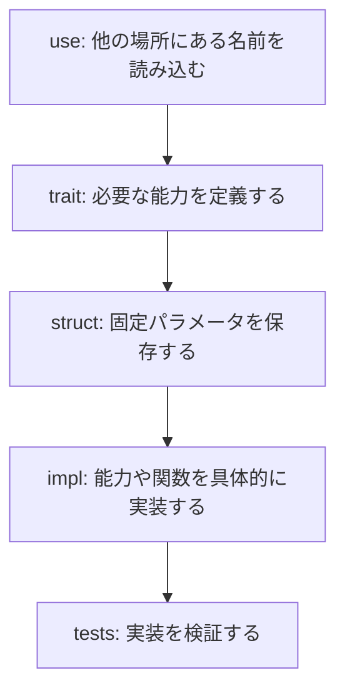
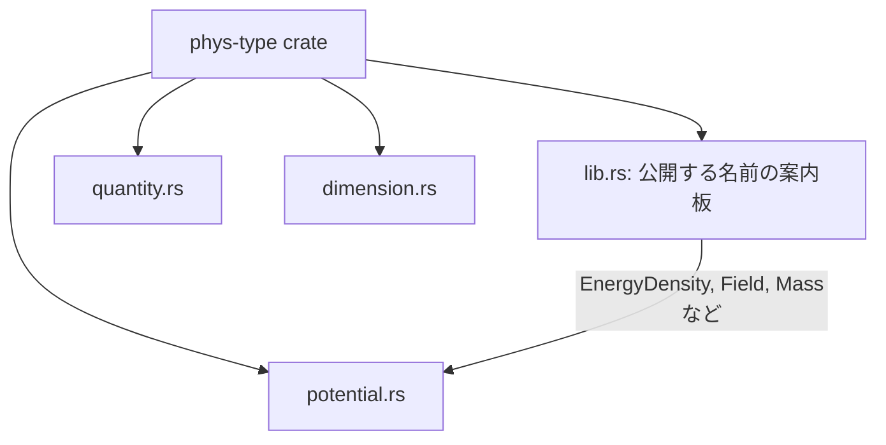
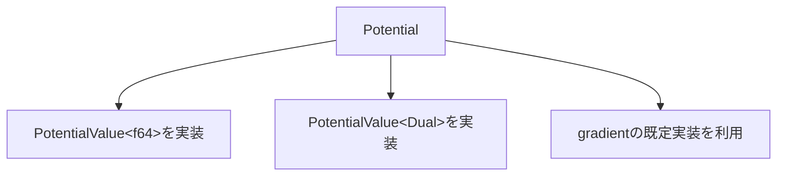
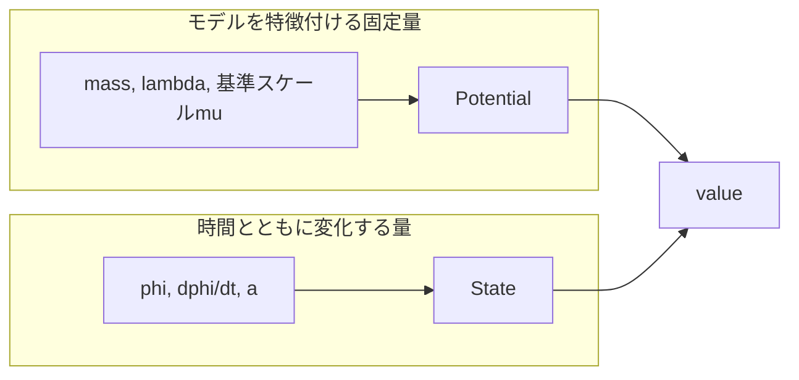

# `potential.rs`で学ぶRust文法

この文書は、Rust初心者が`src/potential.rs`を読めるようになることを
目的とする。

題材は、単一場の二次ポテンシャル

$$
V(\phi)=\frac{1}{2}m^2\phi^2
$$

である。

## ファイル全体の構造



大きく分けると、`potential.rs`は次の部分からなる。

1. `use`による名前の読み込み
2. `PotentialValue<V>`と`Potential` trait
3. `QuadraticPotential` struct
4. ポテンシャル値と自動微分による勾配の実装
5. テスト

## `crate`と`use`

```rust
use core::ops::Mul;

use crate::{Dual, EnergyDensity, Field, Mass, PotentialGradient};
```

`use`は、別の場所にある名前を現在のファイルで短く使えるようにする。
KotlinやJavaの`import`に近い。

`crate`は`create`ではなく、このRustライブラリ全体を指す。



例えば`EnergyDensity`は`lib.rs`で次のように定義されている。

```rust
pub type EnergyDensity<V = f64> = Quantity<M4, V>;
```

これは「質量次元が\(M^4\)である`Quantity`」の別名である。

## `trait`は能力の約束

```rust
pub trait PotentialValue<V> {
    fn value(&self, phi: Field<V>) -> EnergyDensity<V>;
}
```

`trait`は、Kotlinの`interface`に近い。

`PotentialValue<V>`を実装する型は、`value`関数を提供しなければならない。

`<V>`はジェネリクスであり、数値表現の型を表す。

```text
V = f64             通常の浮動小数点数
V = TestNumber      テスト用の数値型
V = Dual             自動微分用の数値型
```

入力と出力で同じ`V`を使うため、次の関係になる。

```text
Field<f64>        -> EnergyDensity<f64>
Field<TestNumber> -> EnergyDensity<TestNumber>
Field<Dual>       -> EnergyDensity<Dual>
```

## `&self`は自分自身を借りる

```rust
fn value(&self, phi: Field<V>) -> EnergyDensity<V>;
```

`self`は、そのメソッドを呼び出した具体的な値である。

`&self`は、その値の所有権を奪わず、読み取り専用で一時的に借りることを
表す。

```rust
let potential = QuadraticPotential::new(mass);
let value = potential.value(phi);
```

`value`の中では`self.mass`を読める。`potential`は消費されないので、同じ
ポテンシャルを何度でも異なる`phi`で評価できる。

```text
&self      読み取り専用で借りる
&mut self  書き換え可能な状態で借りる
self       値そのものを渡す
```

## traitが別のtraitを要求する

```rust
pub trait Potential: PotentialValue<f64> + PotentialValue<Dual> {
    fn gradient(&self, phi: Field) -> PotentialGradient {
        let active = Field::new(Dual::variable(phi.into_value()));
        let result = <Self as PotentialValue<Dual>>::value(self, active).into_value();
        PotentialGradient::new(result.derivative)
    }
}
```

`trait A: trait B`は、「Aを実装するにはBも実装していなければならない」
という意味である。



したがって、現在の`Potential`に必要な能力は次の二つである。

- `f64`でポテンシャル値を計算できる
- `Dual`で同じポテンシャル式を計算できる

この二つを満たす型にはblanket implementationによって`Potential`が自動的に
実装される。勾配の式をポテンシャルごとに手書きする必要はない。

## `struct`はデータを持つ箱

```rust
#[derive(Clone, Copy, Debug, PartialEq)]
pub struct QuadraticPotential {
    pub mass: Mass,
}
```

`QuadraticPotential`は、二次ポテンシャルを特徴付ける質量\(m\)を保存する。


`#[derive(...)]`は、よく使う能力をRustに自動生成させる。

```text
Clone      明示的に複製できる
Copy       代入時に軽量コピーできる
Debug      デバッグ表示できる
PartialEq  ==で比較できる
```

## 固定パラメータと変化する状態を分ける

`QuadraticPotential`は`mass`を持つが、場`phi`は持たない。



同じポテンシャルを、時間ごとに異なる場で評価する。

```rust
potential.value(state.phi)
```

Higgs型ポテンシャルであれば、例えば`mass`と`lambda`を固定パラメータ
として持たせ、`phi`は引数として渡す。

量子補正によって有効結合が場に依存する場合も、固定パラメータを
`Potential`に保存し、現在の場から有効結合を計算する。

$$
\lambda_{\mathrm{eff}}(\phi)
=\lambda_0+\beta\log\left(\frac{\phi}{\mu}\right)
$$

対数の引数$\phi/\mu$は無次元でなければならない。この条件は、
次元型で検査したい対象でもある。

結合定数を決める量自体が別の動的な場であれば、それは固定パラメータ
ではなく`State`に含め、多場ポテンシャルの入力とする。

## `impl`、`new`、`Self`

```rust
impl QuadraticPotential {
    pub const fn new(mass: Mass) -> Self {
        Self { mass }
    }
}
```

`impl QuadraticPotential`は、`QuadraticPotential`専用の関数を追加する。

`new`はRustに組み込まれた特別な関数ではない。「新しい値を作る関数は
`new`と名付ける」という慣習である。

`Self`は、この場所では`QuadraticPotential`という型を表す。

```rust
Self { mass }
```

は次と同じ意味である。

```rust
QuadraticPotential { mass: mass }
```

同じ名前を使うため、`mass: mass`を`mass`と省略できる。

大文字と小文字は意味が異なる。

```text
Self  現在実装している型
self  その型から作られた具体的な値
```

## traitの具体的な実装

```rust
impl<V> PotentialValue<V> for QuadraticPotential
where
    V: Clone + Mul<V, Output = V> + Mul<f64, Output = V>,
    f64: Mul<V, Output = V>,
{
    fn value(&self, phi: Field<V>) -> EnergyDensity<V> {
        self.mass * self.mass * phi.clone() * phi * 0.5
    }
}
```

最初の行は、`QuadraticPotential`に`PotentialValue<V>`の能力を与える。
Kotlinでinterfaceを実装してメソッドをoverrideする場合に近い。Rustでは
`override`というキーワードを使わない。

## `where`による型の条件

`where`は、ジェネリック型`V`に必要な能力を指定する。

```rust
V: Clone + Mul<V, Output = V> + Mul<f64, Output = V>
```

ここで`+`は「または」ではなく「かつ」を意味する。すべての条件を満たす
必要がある。

```text
VはCloneできる
かつ
V x V -> Vという掛け算ができる
かつ
V x f64 -> Vという掛け算ができる
```

一般に、

```rust
Mul<右側の型, Output = 結果の型>
```

と読む。

```text
V:   Mul<V,   Output = V>  は V   x V -> V
V:   Mul<f64, Output = V>  は V   x f64 -> V
f64: Mul<V,   Output = V>  は f64 x V -> V
```

これらは実際の式の各演算に対応する。

```text
self.mass x self.mass  数値部分はf64 x f64
その結果 x phi        数値部分はf64 x V
その結果 x phi        数値部分はV x V
その結果 x 0.5        数値部分はV x f64
```

## `Clone`が必要な理由

式の中で`phi`を二回使う。

```rust
phi.clone() * phi
```

Rustでは最初の演算へ`phi`を渡すと、所有権も移動する可能性がある。
一つを`clone`しておけば、元の`phi`を二回目に使える。

`Clone`は物理上の条件ではなく、Rust上で同じ値を複数回使うための条件
である。

## 最後の式が戻り値になる

```rust
fn value(&self, phi: Field<V>) -> EnergyDensity<V> {
    phi.clone() * phi * self.mass * self.mass * 0.5
}
```

Rustでは、ブロックの最後の式にセミコロンを付けないと、その値が戻り値
になる。

```text
式;  計算するが、その値を戻り値にしない
式   その値を戻り値にする
```

上の実装は\(V(\phi)=m^2\phi^2/2\)を計算する。型システムは結果の
質量次元が\(M^4\)であることも確認する。

## 自動微分による勾配

`gradient`は場の数値を`Dual::variable`へ変換してから、同じ`value`を評価する。

```rust
let active = Field::new(Dual::variable(phi.into_value()));
let result = <Self as PotentialValue<Dual>>::value(self, active).into_value();
PotentialGradient::new(result.derivative)
```

`Dual`は通常の値と、その入力場に関する一次微分を一緒に保持する。

```text
Dual::variable(phi) = (値: phi, 微分: 1)
定数                = (値: 定数値, 微分: 0)
```

掛け算では積の微分則が適用されるため、二次ポテンシャルを評価すると
`result.derivative`は自動的に$m^2\phi$になる。

```text
(u, u') * (v, v') = (uv, u'v + uv')
```

## テスト用モジュール

```rust
#[cfg(test)]
mod tests {
    use super::*;
```

`#[cfg(test)]`は、テスト時だけその部分をコンパイルする指定である。

`mod tests`はテスト用の区画を作る。

`super`は一つ上の区画を指す。`use super::*`は、親の名前空間にある
`QuadraticPotential`、trait、親が読み込んだ型などをテスト内でも使える
ようにする。

## タプル構造体`TestNumber`

```rust
#[derive(Clone, Copy, Debug, PartialEq)]
struct TestNumber(f64);
```

フィールドが一つなので、名前付きフィールドを省略したタプル構造体を
使っている。

```text
TestNumber(3.0)  値を作る
number.0         一番目の値を読む
```

`TestNumber`は自動微分型ではない。ポテンシャルの式が`f64`だけに固定
されていないことを証明するための簡単な偽物である。

## 演算子オーバーロード

```rust
impl Mul for TestNumber {
    type Output = Self;

    fn mul(self, rhs: Self) -> Self::Output {
        Self(self.0 * rhs.0)
    }
}
```

`impl Mul for TestNumber`によって`TestNumber * TestNumber`が可能になる。

`type Output = Self`は、結果も`TestNumber`であることを示す。

`rhs`はright-hand side、つまり演算子の右側である。

```text
a * b
self = a
rhs  = b
```

Rustでは`a * b`を書くと、概念的には`a.mul(b)`が呼ばれる。

左右の型が異なる掛け算は、方向ごとに別の実装が必要である。

```text
TestNumber x f64
f64 x TestNumber
```

数学上は交換可能でも、Rustは一方の実装から他方を自動的には導かない。

## `::`と`.`

```rust
let potential = QuadraticPotential::new(Mass::new(2.0));
let value = potential.value(Field::new(3.0));
```

```text
型::関数()      具体的な値がまだない。newにはselfがない
値.メソッド()   具体的な値をselfとして使う
```

## 型推論

```rust
let value = potential.value(Field::new(3.0));
```

`3.0`は既定で`f64`なので、Rustは次のように型を推論する。

```text
3.0
-> Field<f64>
-> PotentialValue<f64>
-> EnergyDensity<f64>
```

一方、

```rust
let value = potential.value(Field::new(TestNumber(3.0)));
```

では、

```text
TestNumber(3.0)
-> Field<TestNumber>
-> PotentialValue<TestNumber>
-> EnergyDensity<TestNumber>
```

と推論される。

## 自動微分勾配の有限差分テスト

自動微分で求めた勾配

$$
V_{,\phi}=m^2\phi
$$

を、中心差分

$$
V'(\phi)\simeq
\frac{V(\phi+h)-V(\phi-h)}{2h}
$$

と比較する。

```rust
let numerical = (forward - backward) / (2.0 * step);
let analytic = potential.gradient(Field::new(phi)).into_value();

assert!((numerical - analytic).abs() < 1.0e-18);
```

これは、自動微分の結果を独立した数値微分と突き合わせるテストである。
さらに三次式のテストにより、`gradient`が二次ポテンシャル専用の式を
使っていないことも確認している。

## 二階微分の`Jet<N>`

多場摂動では勾配だけでなくHessian (V_{,IJ}) が必要になる。
`Jet<N>`は通常の値、`N`成分の勾配、`N x N`のHessianを一緒に持つ。

```rust
let x = Jet::<2>::variable(2.0, 0);
let y = Jet::<2>::variable(3.0, 1);
let result = x * x * y;
```

この一度の評価から、値12、勾配`[12, 4]`、Hessian
`[[6, 4], [4, 0]]`が得られる。`TwiceDifferentiableMultifieldPotential`
も同じ仕組みを使うため、各ポテンシャルにHessianの式を重複して書かない。
曲がった場の空間では、座標Hessianから

$$
V_{;IJ}=V_{,IJ}-\Gamma^K{}_{IJ}V_{,K}
$$

を構成する。

## このファイルから読み取れる設計原則

1. 物理次元と数値表現を`Quantity<Dimension, Value>`で分離する。
2. モデルを特徴付ける固定パラメータと、時間変化する状態を分離する。
3. ポテンシャルの式を一度だけ書き、数値型を交換可能にする。
4. 一次勾配は`Dual`、値・全勾配・Hessianは`Jet<N>`で同じ式を評価して
   自動的に求める。
5. 高階微分では、微分階数ごとにポテンシャルの式を増やさず、必要な階数を
   保持できる数値型へ差し替える。
