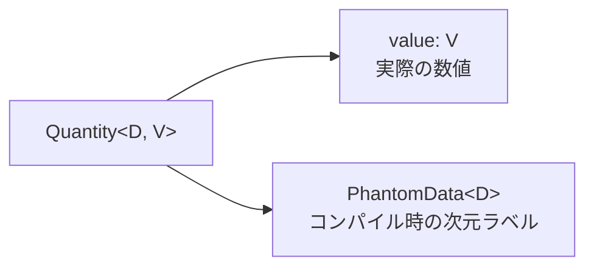
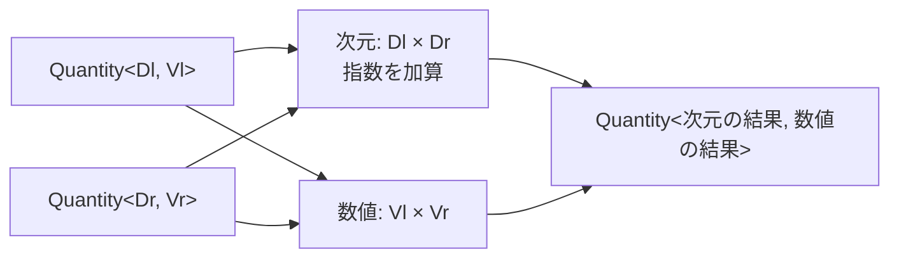
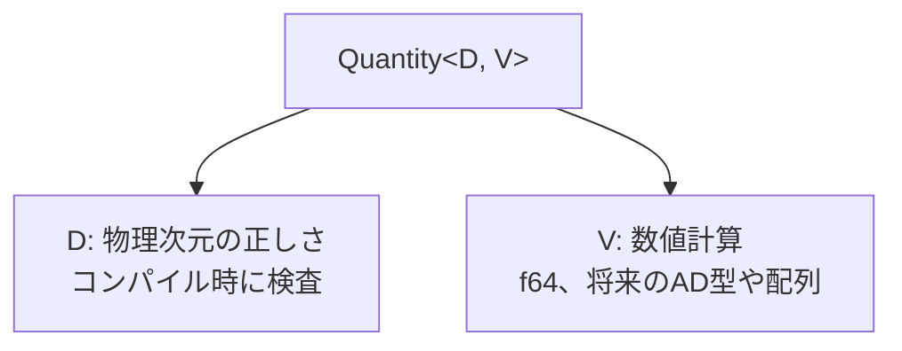

# `quantity.rs`で学ぶRust文法

この文書は、Rust初心者が`src/quantity.rs`を読めるようになることを
目的とする。

`Quantity<D, V>`は、このライブラリの中心となる型である。

```text
Quantity<D, V>
         |  |
         |  +-- 数値の型（最初はf64、将来は自動微分型など）
         +----- 物理次元の型（M^1、M^4など）
```

例えば、スカラー場は次の型で表される。

```rust
pub type Field<V = f64> = Quantity<M1, V>;
```

## `Quantity`の構造

```rust
#[derive(Clone, Copy, Debug, Default, PartialEq, PartialOrd)]
#[repr(transparent)]
pub struct Quantity<D, V> {
    value: V,
    dimension: PhantomData<D>,
}
```

`struct`は、いくつかのデータをまとめる箱である。



`D`と`V`はジェネリクスであり、具体的な型を後から当てはめる。

```text
Quantity<M1, f64>  = f64の値を持つ質量次元M^1の物理量
Quantity<M4, f64>  = f64の値を持つ質量次元M^4の物理量
```

同じ`f64`を保存していても、`D`が異なればRustにとっては別の型になる。

## `PhantomData<D>`は大きさを持たない型ラベル

```rust
dimension: PhantomData<D>,
```

`Quantity`は、次元`D`の値そのものを保存する必要はない。次元は、計算が
正しいかコンパイラに検査させるためのラベルだからである。

`PhantomData<D>`は、「実行時のデータは持たないが、この型は`D`と関係が
ある」とコンパイラに伝える。

```text
実行時に保存するもの       value: 0.17
コンパイル時だけ使うもの   D: M1
```

`PhantomData<D>`はゼロサイズ型なので、通常はメモリ領域を増やさない。

## `#[repr(transparent)]`とメモリ配置

```rust
#[repr(transparent)]
pub struct Quantity<D, V> {
    value: V,
    dimension: PhantomData<D>,
}
```

`#[repr(transparent)]`は、`Quantity<D, V>`のメモリ配置を、唯一の
非ゼロサイズのフィールド`V`と同じにする指定である。

`V = f64`で、値がアドレス1000から8バイトを使う場合を考える。

```text
アドレス       1000 1001 1002 1003 1004 1005 1006 1007
Quantity全体   [--------------- 8 bytes ----------------]
value: f64     [--------------- 8 bytes ----------------]
PhantomData    [0 bytes]
```

`Quantity`用に8バイトを確保し、その中にさらに`f64`用の8バイトを確保
するのではない。`Quantity`という一つの箱の実体が、そのまま`value`の
8バイトである。

したがって、次の二つは型が異なるが、指す先頭アドレスは同じになる。

```text
&Quantity<M1, f64>  型付きの箱への参照
&f64                箱の中のvalueへの参照
```

型が同じという意味ではない。コンパイラは型の違いを保ったまま、余分な
実行時コストを発生させない。

この性質はテストでも確認している。

```rust
assert_eq!(
    core::mem::size_of::<Field>(),
    core::mem::size_of::<f64>()
);
```

## `derive`で基本的な能力を自動生成する

```rust
#[derive(Clone, Copy, Debug, Default, PartialEq, PartialOrd)]
```

`derive`は、よく使うtraitの実装をRustに生成させる。

```text
Clone       明示的に複製できる
Copy        代入などで軽量コピーできる
Debug       デバッグ表示できる
Default     デフォルト値を作れる
PartialEq   == と != で比較できる
PartialOrd  <、<=、>、>= で比較できる
```

これらの能力は、内部の`V`も対応している場合に利用できる。例えば
`Quantity<D, V>`が常に`Copy`になるわけではなく、`V`が`Copy`のときに
限られる。

## `new`、`value`、`into_value`

```rust
impl<D, V> Quantity<D, V> {
    pub const fn new(value: V) -> Self {
        Self {
            value,
            dimension: PhantomData,
        }
    }

    pub const fn value(&self) -> &V {
        &self.value
    }

    pub fn into_value(self) -> V {
        self.value
    }
}
```

三つの関数の役割は次のとおりである。

```text
Quantity::new(value)  生の値に次元型を付けてQuantityを作る
quantity.value()      Quantityを借りて、中の値への参照を得る
quantity.into_value() Quantityを消費して、中の値を取り出す
```

`&self`は借用なので、呼び出した後も元の`Quantity`を使える。
`self`は所有権を受け取るので、`into_value`は元の`Quantity`を消費する。

## 同じ次元だけを加算する

```rust
impl<D, Lhs, Rhs> Add<Quantity<D, Rhs>> for Quantity<D, Lhs>
where
    Lhs: Add<Rhs>,
{
    type Output = Quantity<D, <Lhs as Add<Rhs>>::Output>;

    fn add(self, rhs: Quantity<D, Rhs>) -> Self::Output {
        Quantity::new(self.value + rhs.value)
    }
}
```

`Add<A> for B`は、「`B + A`を可能にする」という意味である。

この実装では左右に同じ`D`が現れる。

```text
左辺  Quantity<D, Lhs>
右辺  Quantity<D, Rhs>
               ^
          同じ次元が必要
```

したがって、次の加算は可能である。

```text
Field + Field  -> Field
M^1   + M^1    -> M^1
```

一方、次の加算に対応する実装は存在しない。

```text
Field + Time
M^1   + M^-1   -> コンパイルエラー
```

実行時に`if`文で次元を検査するのではない。誤った加算そのものをRustの
型として作れないようにしている。

## `type Output`は演算結果の型

```rust
type Output = Quantity<D, <Lhs as Add<Rhs>>::Output>;
```

`Add` traitには、足し算の結果がどの型になるかを表す関連型`Output`が
ある。

```text
次元の結果   Dのまま
数値の結果   Lhs + Rhs が返す型
```

`<Lhs as Add<Rhs>>::Output`は、「`Lhs`を左辺、`Rhs`を右辺として加算
した結果の型」を明示している。

減算も同じ構造であり、符号反転では数値型`V`の`Neg`能力を利用する。

## 乗算では質量次元の指数を足す

```rust
impl<Dl, Dr, Vl, Vr> Mul<Quantity<Dr, Vr>> for Quantity<Dl, Vl>
where
    Dl: DimMul<Dr>,
    Vl: Mul<Vr>,
{
    type Output = Quantity<
        <Dl as DimMul<Dr>>::Output,
        <Vl as Mul<Vr>>::Output,
    >;
}
```

四つのジェネリック型を左右に分けて読む。

```text
Dl  左辺の次元       Vl  左辺の数値型
Dr  右辺の次元       Vr  右辺の数値型
```

乗算では、次元の演算と数値の演算を別々に行う。



自然単位系では、例えば次のようになる。

$$
M^a M^b = M^{a+b}
$$

```text
Field × Mass = M^1 × M^1 = M^2
M^1/2 × M^1/2 = M^1
```

`DimMul`が次元の指数を加算し、`Mul`が実際の数値を掛ける。

## 除算では質量次元の指数を引く

除算も乗算と同じ構造を持つが、`DimDiv`が指数を引く。

$$
\frac{M^a}{M^b}=M^{a-b}
$$

```text
EnergyDensity / M^2 = M^4 / M^2 = M^2
Field / Field        = M^1 / M^1 = M^0
```

同じ次元の量を割ると、`Dimensionless`、すなわち無次元量になる。

## 生の`f64`は無次元の係数として扱う

```rust
impl<D, V> Mul<f64> for Quantity<D, V> { ... }
impl<D, V> Div<f64> for Quantity<D, V> { ... }
impl<D> Mul<Quantity<D, f64>> for f64 { ... }
```

生の`f64`は無次元の係数として扱うため、次元は変化しない。

```text
Quantity<M^1> × 3.0  -> Quantity<M^1>
Quantity<M^1> / 4.0  -> Quantity<M^1>
3.0 × Quantity<M^1>  -> Quantity<M^1>
```

Rustでは`A * B`と`B * A`は別々の実装である。そのため、左右どちらにも
生の数値を書けるようにするには、両方向を実装する必要がある。

現在、左からの係数倍は`f64 * Quantity<D, f64>`に限定されている。
将来`ndarray`などを数値型にするときは、Rustのtrait実装規則も考慮して
拡張方法を検討する。

## `sqrt`は数値と次元の両方に条件がある

```rust
impl<D, V> Quantity<D, V>
where
    D: DimSqrt,
{
    pub fn sqrt(self) -> Quantity<<D as DimSqrt>::Output, V>
    where
        V: Sqrt,
    {
        Quantity::new(self.value.sqrt_value())
    }
}
```

平方根を計算するには、二種類の能力が必要である。

```text
D: DimSqrt  次元の指数を半分にできる
V: Sqrt     数値の平方根を計算できる
```

例えば、

$$
\sqrt{M^2}=M^1
$$

であるため、`Quantity<M2, f64>.sqrt()`の結果は
`Quantity<M1, f64>`になる。

数値部分の平方根は、独自の`Sqrt` traitで分離している。

```rust
pub trait Sqrt {
    fn sqrt_value(self) -> Self;
}
```

現在は`f64`に実装している。将来、自動微分用の数値型が`Sqrt`を実装
すれば、`Quantity`の平方根の仕組みを変更せずに利用できる。

## 半整数刻みから外れる平方根は拒否する

現在の質量次元は、半整数刻みを扱う。

```text
..., M^-1, M^-1/2, M^0, M^1/2, M^1, M^3/2, ...
```

したがって、次の平方根は表現できる。

```text
sqrt(M^4) = M^2
sqrt(M^2) = M^1
sqrt(M^1) = M^1/2
```

一方、次の結果は四分の一刻みになる。

$$
\sqrt{M^{1/2}}=M^{1/4}
$$

`M1/4`は現在の対応範囲にないため、`MHalf`には`DimSqrt`が実装されず、
コンパイルエラーになる。数値`4.0`の平方根を計算できるかどうかとは
別の問題である。

任意の有理数次元への一般化は、修正重力の多場摂動計算で実際に必要に
なったときに検討する。

## Friedmann方程式を型で追う

テストでは、Friedmann方程式に似た式全体の次元を検査している。

```rust
let total: Quantity<M4, f64> = pi * pi * 0.5 + potential;
let hubble: Hubble = (total / (m_pl * m_pl * 3.0)).sqrt();
```

対応する式は次のとおりである。

$$
H = \sqrt{\frac{\dot{\phi}^2/2 + V(\phi)}{3M_{\mathrm{pl}}^2}}
$$

型を一段ずつ追う。

```text
pi                         M^2
pi * pi * 0.5             M^4
potential                  M^4
total                      M^4
m_pl * m_pl * 3.0         M^2
total / denominator        M^2
sqrt(M^2)                  M^1 = Hubble
```

途中で次元が合わなければ、最終結果を得る前にコンパイルエラーになる。

## 正しい計算と誤った計算を別々にテストする

`quantity.rs`の単体テストは、正しい式が期待どおり計算できることを確認
する。

```text
Field + Field          -> 成功
Field × Mass           -> M^2
EnergyDensity / M^2    -> M^2
```

一方、`tests/compile_fail/`は、誤った式がコンパイル時に拒否されることを
確認する。

```text
Field + Time           -> コンパイルエラー
Field - FieldVelocity  -> コンパイルエラー
M^4の値をFieldへ代入   -> コンパイルエラー
```

例えば、次のファイルは意図的に誤ったコードを含む。

```rust
let phi = Field::new(1.0);
let t = Time::new(1.0);
let _invalid = phi + t;
```

`trybuild`がこのファイルをコンパイルし、実際のエラー出力を、対応する
`.stderr`ファイルに保存された正解見本と比較する。

```text
add_different_dimensions.rs      意図的に間違えたコード
add_different_dimensions.stderr  期待するコンパイルエラー
```

これにより、単に何らかの理由で失敗するのではなく、意図した型エラーで
失敗することまでテストできる。

## この設計で得られること

`Quantity<D, V>`は、二つの関心事を分離する。



- 次元の間違いは、実行する前にコンパイラが発見する。
- 次元ラベルは、通常は実行時のメモリを増やさない。
- 数値型`V`を交換できるので、自動微分や配列への拡張余地がある。
- 物理式そのものが、型のテストとして機能する。

現在の実装は単一場背景計算に必要な最小構成である。拡張は、具体的な
物理計算から必要性が生じた段階で行う。
