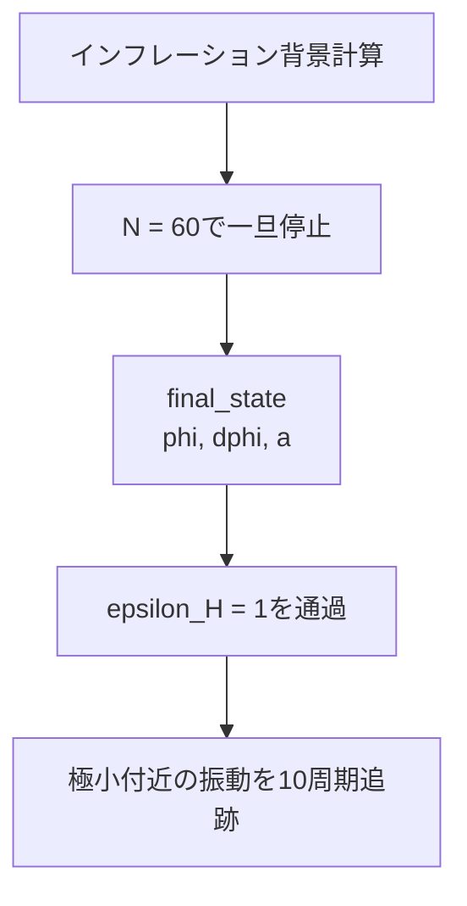

# 背景計算の可視化設計

## 目的

単一場インフレーションの背景解を、計算が物理的に妥当か短時間で確認
できる図にする。

可視化はRustライブラリの責務には含めない。Rustは物理計算と次元検査を
担当し、CSVを境界としてPythonへ結果を渡す。


## 採用する道具

- 可視化スクリプトはPythonで記述する。
- 静的な研究用グラフにはMatplotlibを使う。
- 表形式の数値の読み込みと処理にはNumPyを使う。
- Python環境と依存関係は`uv`で再現する。
- Rust crate自体にはPython依存を追加しない。

gnuplotは軽量で現在も利用可能だが、本プロジェクトの主たる可視化手段
にはしない。複数パネル、論文用の体裁、将来の追加解析との連携を考え、
Matplotlibを選ぶ。

対話的な拡大、ホバー、Web共有が必要になった場合は、将来Plotlyを追加
できる。ただし、MVPには含めない。

## 入出力

可視化スクリプトは次のファイルを入力とする。

```text
diagnostics/trajectory.csv
```

必要な列は、Rust側の`Record::CSV_HEADER`と一致する。

```text
t,a,e_folds,phi,dphi,H,epsilon_h
```

値はPlanck単位で無次元化してCSVへ出力されている。

```text
t         t M_pl
a         スケール因子
e_folds   N = ln(a/a_initial)
phi       phi/M_pl
dphi      (dphi/dt)/M_pl^2
H         H/M_pl
epsilon_h epsilon_H
```

出力は同じ図の二形式とする。

```text
diagnostics/background.png  日常的な確認用
diagnostics/background.pdf  論文・資料用のベクター画像
```

PNGとPDFは同じ描画処理から生成し、内容が食い違わないようにする。

## 背景解の四パネル図

横軸は全パネルでe-folding number `N`を共有する。

```text
+-----------------------+-----------------------+
| phi / M_pl            | dphi/dt / M_pl^2      |
|       vs N            |       vs N            |
+-----------------------+-----------------------+
| H / M_pl              | epsilon_H             |
|       vs N            |       vs N            |
|                       | epsilon_H = 1 の線     |
+-----------------------+-----------------------+
```

四つのパネルの目的は次のとおりである。

| パネル | 確認すること |
| --- | --- |
| $\phi(N)$ | 場が期待する方向へ滑らかに発展しているか |
| $\dot{\phi}(N)$ | 場の速度とslow-roll的な振る舞い |
| $H(N)$ | Hubble率が背景発展に沿って変化しているか |
| $\epsilon_H(N)$ | インフレーション終了条件$\epsilon_H=1$への到達 |

`a`はCSVには残すが、最初の図には描かない。初期値を$a_0$とすると、

$$
N=\ln\left(\frac{a}{a_0}\right),
\qquad
a=a_0 e^N
$$

であり、`a`と`N`は同じ背景発展を別の形で表すからである。指数的に増える
`a`よりも、研究上よく使う`N`を横軸にする。

## インフレーション中の位相空間

異なる初速度から始めた解がslow-roll attractorへ収束することを、位相空間
で確認する。

```text
横軸  phi / M_pl
縦軸  (dphi/dt) / M_pl^2
```

入力は既存の`diagnostics/attractor.csv`とする。初期速度ごとの軌道を
色分けした実線で描き、slow-roll予測を黒い破線で重ねる。軌道上には
時間発展の向きが分かる矢印を置く。

```text
diagnostics/attractor.png
diagnostics/attractor.pdf
```

この図はインフレーション中のattractorを調べる図であり、極小付近の
振動期は含めない。

## インフレーション後の振動

### 対象とする物理

二次ポテンシャル中の、崩壊しないスカラー場のコヒーレントな振動を
対象とする。粒子生成、崩壊率、他の場との相互作用を含むreheatingその
ものは、この診断の対象外である。

$$
V(\phi)=\frac{1}{2}m^2\phi^2
$$

この系では、振動平均した状態方程式が

$$
\langle w\rangle\simeq 0
$$

となり、平均的にmatter-dominatedな背景発展が期待される。

$$
\rho\propto a^{-3},
\qquad
a\propto t^{2/3}
$$

これは背景方程式と数値積分を合わせて検証する物理テストとして使える。

### 計算の再開

通常の背景計算は`N = 60`または`epsilon_H >= 1`で停止する。現在の基準
初期値では`N = 60`へ先に到達するため、その時点の`BackgroundRun::final_state`
を次の計算の初期状態として再利用する。



運動方程式は切り替えない。停止条件だけをインフレーション用の条件から
振動回数へ変更する。

### 振動回数による停止

`phi`の符号が変わった回数をゼロ交差として数える。二回のゼロ交差を
一周期とし、20回のゼロ交差、すなわち10周期で停止する。

```text
phi > 0 -> phi < 0   1回目のゼロ交差
phi < 0 -> phi > 0   2回目のゼロ交差 = 1周期
...
20回目                          = 10周期
```

時間やe-fold数ではなく実際の振動を数えるため、周期が少し変化しても
観測する周期数を一定に保てる。

### 物理スケールに基づく時間刻み

二次ポテンシャルでは、Hubble時間と振動時間の短い方を100分割する。

$$
\Delta t=\frac{1}{100\max(H,m)}
$$

したがって、

```text
H > m   Delta t = 1/(100 H)
H <= m  Delta t = 1/(100 m)
```

となる。振動期には`m Delta t = 0.01`となり、一周期を約628ステップで
解く。10周期は約6,280ステップとなる。

これは局所誤差を推定する一般的な適応刻みではなく、方程式に現れる
物理的な最短時間スケールに基づく可変刻みである。`rk4_step`には各ステップ
で計算した`Delta t`を渡す。

時間刻みを半分にした結果とも比較し、位相軌道や振動平均が十分収束して
いることを確認する。

一般のポテンシャルでは、固定パラメータ`m`の代わりに局所的な有効振動数

$$
\omega_{\mathrm{eff}}^2
=\left|\frac{d^2V}{d\phi^2}\right|
$$

を利用できる。二階微分を安定して取得する必要があるため、この自動化は
自動微分の導入後に行う。MVPのpost-inflation診断は二次ポテンシャルに
限定する。

### 振動期の四パネル図

```text
+-----------------------+-----------------------+
| phi - dphi phase      | phi(t)                |
| space                 | field oscillation     |
+-----------------------+-----------------------+
| w(t) and moving       | a(t) and the          |
| average               | matter prediction     |
+-----------------------+-----------------------+
```

状態方程式は、運動エネルギー`K`を用いて計算する。

$$
K=\frac{1}{2}\dot{\phi}^2,
\qquad
w=\frac{K-V}{K+V}
$$

スケール因子のパネルには、振動開始時の`a_end`、`H_end`、`t_end`から作る
matter-dominated予測を破線で重ねる。

$$
\frac{a_{\mathrm{matter}}(t)}{a_{\mathrm{end}}}
=\left[1+\frac{3}{2}H_{\mathrm{end}}
(t-t_{\mathrm{end}})\right]^{2/3}
$$

出力は次の二形式とする。

```text
diagnostics/oscillation.png
diagnostics/oscillation.pdf
```

この図によって、位相空間での回転、`w`の振動と`<w> -> 0`、および
matter-likeなスケール因子の発展を一度に確認する。

## ファイル配置

```text
plots/
├── background.py           背景解の四パネル
├── attractor.py            インフレーション中の位相空間
└── oscillation.py          振動期の四パネル

diagnostics/
├── trajectory.csv          Rustが生成する入力
├── background.png          Pythonが生成する確認用画像
├── background.pdf          Pythonが生成する論文・資料用画像
├── attractor.csv           複数の初速度による軌道
├── attractor.png
├── attractor.pdf
├── oscillation.csv         振動期の時系列
├── oscillation.png
└── oscillation.pdf
```

`diagnostics/`は生成物の置き場所であり、ソースコードは`plots/`へ分離する。

## 実行方法

背景解を計算する。

```sh
cargo run --release --example diagnostics
```

生成されたCSVを可視化する。

```sh
uv run plots/background.py diagnostics/trajectory.csv
uv run plots/attractor.py diagnostics/attractor.csv
uv run plots/oscillation.py diagnostics/oscillation.csv
```

可視化スクリプトには、`uv`が読み取れるインライン依存関係メタデータを
記述する。利用者が手作業で仮想環境を作ったり、グローバル環境へ
`pip install`したりしなくても実行できるようにする。

入力CSVのパスはコマンドライン引数で受け取る。出力先は入力ファイルと
同じディレクトリとし、ファイル名を`background.png`および
`background.pdf`とする。

## 表示上の原則

- 四つのパネルで横軸を共有する。
- 軸名には物理量だけでなくPlanck単位での規格化も記す。
- 色だけに依存せず、線種や注釈でも意味を区別できるようにする。
- 過剰な装飾を避け、計算結果と終了条件を読み取りやすくする。
- $\epsilon_H$のパネルには、終了条件を示す$\epsilon_H=1$の水平線を引く。
- PNGとPDFのレイアウトを同一にする。

## エラー時の扱い

次の場合は、不完全な図を黙って生成せず、理由を表示して終了する。

- 入力CSVが存在しない。
- 必要な列が欠けている。
- データ行がない。
- 出力先へ書き込めない。

NaNや無限大が含まれる場合の詳細な診断表示は、背景積分側の異常終了設計
と合わせて後から追加する。

## 可視化MVPの完了条件

1. `diagnostics` exampleが`trajectory.csv`を生成できる。
2. 一つのコマンドでCSVから四パネル図を生成できる。
3. PNGとPDFの両方が生成される。
4. 軸、単位、$\epsilon_H=1$の終了線を図から読み取れる。
5. 入力不足を明確なエラーとして報告する。

位相空間とpost-inflation診断については、次も満たす。

6. 異なる初速度からslow-roll attractorへ向かう軌道を描ける。
7. インフレーション終了後に10周期の振動を追跡できる。
8. `phi`--`dphi`位相空間、`w`とその平均、`a(t)`とmatter予測を描ける。
9. 物理スケールによる刻みと、その半分の刻みで結果の収束を確認できる。

## 実装結果

基準の100分割と、刻みを半分にした200分割で10周期を計算した結果、差は
次の範囲に収まった。

```text
10周期の経過時間       8.1e-5
最終スケール因子       5.3e-5
時間平均 <w>           2.6e-5
```

基準計算で得られた時間平均は`<w> = 0.0085`であり、二次ポテンシャルに
期待されるmatter-likeな`<w> -> 0`を数値的に確認できた。

以下の図をPNGとPDFの両形式で生成し、PNGを目視確認した。

```text
background   インフレーション背景の四パネル
attractor    異なる初速度からの位相軌道
oscillation  振動、wの平均、matter-likeな膨張
```

## MVP後の候補

- RK4の収束次数を確認するlog-log図
- Plotlyによる対話的な探索
- 論文向けの共通スタイル設定
- 一般のポテンシャルに対する`omega_eff`ベースの刻み自動化
- 崩壊項や他場との結合を含むreheating

これらは、現在の三種類の診断図を基礎として一つずつ追加する。
